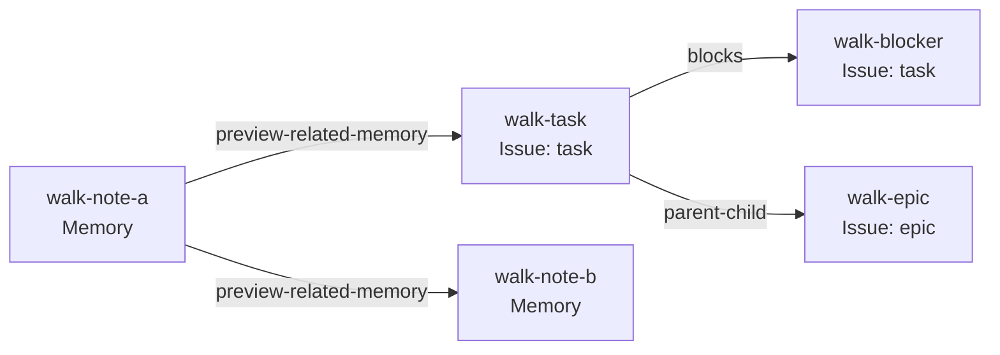

# Beads Graph Preview 2 runbook

Use this guide with the Preview 2 `bd` program in a new workspace. The examples build on one another, so run them in order. This is experimental software: use practice data that you can recreate. See **Known Limitations** before using it for other work.

Some examples use `jq` to copy an ID or revision from a command result. Install `jq` if needed. If a value-capturing command prints nothing, stop and check the previous step before continuing.

## 1. Start a workspace

Start in a new, empty directory outside any existing Beads workspace. The `--graph-mode link` flag selects the Preview 2 graph model. For now, `bd init` also requires a unique Scope URL even when you only use the CLI. **That is a temporary Preview 2 requirement.** The URL identifies your workspace; it does not contact or start a web service.

```sh
# Create and initialize a new embedded graph workspace, then inspect its status and Types.
mkdir beads-preview2-test
cd beads-preview2-test
bd init --graph-mode link --scope-url "https://example.invalid/preview2/$(date +%s)/"
bd status --graph
bd types
```

This uses embedded Dolt storage. To try BDP, use the separate shared-server workspace in [Optional BDP Read exercise](#8-optional-bdp-read-exercise) *instead* of running the commands above. BDP requires a shared-server workspace.

## 2. Beads, Links, and Types

One of the foundational building blocks of Beads is the graph.

In the shipping product, the nodes are called **Issues**, and the edges are called **Dependencies**. Issues can be bugs, tasks, or features. Dependencies can be `blocks`, `parent-child`, and other kinds of relationships.

That model fits work tracking for people and agents. To add other capabilities, we need records that do not carry all the behavior of an Issue or Dependency.

Chris's Memory proposal prompted the generalization you can try in this preview.

In the new generalized model, **Beads** are the nodes and **Links** are the edges connect Beads. Issues are specific types of Beads; Dependencies are specific types of Links. The familiar Issue and Dependency choices remain available.

Run `bd types` to see the names accepted by `--type`. In a new Preview 2 workspace, here are the registerd Bead and Link types you can use:

```text
Bead Types (14):
  preview-memory            Memory Preview
  task                      Task Issue
  bug                       Bug Issue
  feature                   Feature Issue
  chore                     Chore Issue
  epic                      Epic Issue
  decision                  Decision Issue
  spike                     Spike Issue
  story                     Story Issue
  milestone                 Milestone Issue
  message                   Message Issue
  molecule                  Molecule Issue
  gate                      Gate Issue
  event                     Event Issue

Link Types (22):
  preview-related-memory    Related Memory Preview
  example-cites             Example Cites
  example-follows           Example Follows
  blocks                    Blocking Dependency
  parent-child              Parent/Child Dependency
  conditional-blocks        Conditional Blocks Dependency
  waits-for                 Waits For Dependency
  related                   Related Dependency
  discovered-from           Discovered From Dependency
  replies-to                Replies To Dependency
  relates-to                Relates To Dependency
  duplicates                Duplicates Dependency
  supersedes                Supersedes Dependency
  authored-by               Authored By Dependency
  assigned-to               Assigned To Dependency
  approved-by               Approved By Dependency
  attests                   Attests Dependency
  tracks                    Tracks Dependency
  until                     Until Dependency
  caused-by                 Caused By Dependency
  validates                 Validates Dependency
  delegated-from            Delegated From Dependency
```

This preview has several new Bead and Link types that are placeholders:

* `preview-memory` is a placeholder type for a Memory Bead.
* `preview-related-memory` is a placeholder type for a relation between a Memory and a Bead of any type.
* `example-cites` and `example-follows` are example Link types for building graphs of memories.

If you omit `--type`, `bd create` makes a `task` Issue. The shorter `bd link SOURCE TARGET` makes a `blocks` Dependency when you omit `--type`; `bd link create SOURCE TARGET` requires an explicit type.

`bd create` and `bd link create` refuse an unrecognized `--type`. The choices displayed by `bd types` are fixed in this preview; users cannot register new graph Types here.

> **Compatibility note:** The older `bd dep add --type` path still accepts an arbitrary nonempty Dependency label of up to 32 bytes. It does not register a new graph Type. Only built-in labels have their defined workflow behavior.

Look for a future blog post going over all the things related to bead and link types. For now, this should be all we need to know to use the product.

## 3. Working with Beads and Links

Beads and Links have much in common:

- Each has a unique ID. IDs can contain slashes, so you can organize them into paths.
- Each has properties checked against its Type. Beads and Links also have separate metadata. Dependency Link metadata cannot be set in this preview; `preview-related-memory` and the example Link Types support it.
- Each has saved versions that you can inspect and compare.

The common operations for Beads and Links follow two command paths: top-level `bd` commands for Beads, and `bd link` subcommands for Links. The limits for each command appear at the end of this guide.

| Task | Beads | Links |
| --- | --- | --- |
| Create | `bd create` | `bd link create` |
| List | `bd list` | `bd link list` |
| Show one | `bd show` | `bd link show` |
| Update | `bd update` | `bd link update` |
| Delete | `bd delete` | `bd link delete` |
| List versions | `bd versions` | `bd link versions` |
| Compare versions | `bd compare` | `bd link compare` |
| Count | `bd count` (Issues) | `bd link count` |

For familiarity and convenience, the CLI also has narrower shortcuts:

| Shortcut | Closest general command | Difference |
| --- | --- | --- |
| `bd remember` | `bd create --type preview-memory` or `bd update` | `remember` takes the Memory body as a positional argument. |
| `bd recall` | `bd show` | `recall` prints the body rather than the full record. |
| `bd forget` | `bd delete --force` | `forget` deletes a Memory immediately. |
| `bd memories` | `bd list --type preview-memory` | `memories` also searches Memory titles and bodies. |
| `bd dep add` | `bd link create` | `dep add` accepts an Issue pair and a Dependency kind. |
| `bd dep remove` | `bd link delete --force` | `dep remove` selects a blocking Dependency by Issue pair; `link delete` selects a Link ID. |
| `bd history` | `bd versions` | Both list saved versions. |
| `bd new`, `bd q` | `bd create` | Short Issue creation forms. |

`bd link query` is not available in this preview.

## 4. Memory and Issue Beads

Issue Beads have been part of the product from the beginning; Memory Beads are new in this preview. A **Memory** stores reusable information. It has two properties: string `title` and a Markdown `body`.

The next four examples create Memories about release policies. They show the general `create` form, shorter field flags, and the Memory-specific `remember` command.

### Creating Beads

Create the first Memory by supplying its Type-checked properties and separate metadata as JSON:

```sh
# Create a Memory with JSON properties and separate metadata.
bd create --type preview-memory --id policy-a \
  --properties '{"title":"Policy A","body":"Review *before* publishing."}' \
  --metadata '{"origin":"manual test"}'
```

Create the second with individual field flags:

```sh
# Create a second Memory with the title and body flags.
bd create --type preview-memory --id policy-b --title 'Policy B' --body 'Retain the review evidence.'
```

The positional argument can also supply the title:

```sh
# Create a Memory using the positional title.
bd create 'Policy C' --type preview-memory --id policy-c --body 'Review policy changes before release.'
```

Finally, `remember` chooses the Memory Type for you and takes the body as its positional argument:

```sh
# Create a Memory with the remember shortcut.
bd remember 'Keep the release checklist.' --id policy-d --title 'Policy D'
```

Create two task Issues for the Issue workflow example later in the guide:

```sh
# Create a prerequisite and work that waits for it.
bd create 'Blocking prerequisite' --id blocker --type task
bd create 'Work waiting on prerequisite' --id blocked-work --type task
```

These use the general `bd create` form. `bd remember` is specific to Memories.

### Listing Beads

The general `list` command supports all Bead types, including Issues and Memories. With no filter, it lists both:

```sh
# List Beads as readable rows and as JSON records.
bd list
bd list --format records-json
```

Use `--type` to see one choice at a time:

```sh
# Filter the Bead list to task Issues, then Memories.
bd list --type task
bd list --type preview-memory
```

The Memory-specific `bd memories` command is a convenient alternative and can search Memory titles and bodies:

```sh
# List all Memories with the Memory-specific shortcut.
bd memories --all
```

> **Known limitation:** `bd list --json` shows Issues only. Use `--format records-json` when you want JSON for both Issues and Memories. On `bd list`, `--all` includes closed and pinned Issues and removes the default row limit within Preview 2's bounds; it does not add Links. Use `bd link list` for Links.

### Read a Bead

`list` finds Beads that meet your criteria. Once you have an ID, `bd show` reads the full current record:

```sh
# Show a Memory and an Issue as complete graph records.
bd show policy-a --format graph-json
bd show blocker --format graph-json
```

The Memory-specific `recall` command displays only a Memory's body. It refuses an Issue ID:

```sh
# Read a Memory body.
bd recall policy-a

# Expected refusal: recall takes a Memory ID, not an Issue ID.
bd recall blocker
```

### Updating Beads

The properties and metadata of a Bead (or Link) are separate JSON objects. You can update either or both with `bd update`.

Three flags control property edits:

| Flag | Effect |
| --- | --- |
| `--properties '{...}'` | Change only the named properties; leave the others alone. |
| `--replace-properties '{...}'` | Replace all writable properties; include every required field. |
| `--patch '[...]'` | Apply an ordered JSON Patch-style list of `add`, `replace`, or `remove` operations. |

Here are these three forms in use:

```sh
# Merge, replace, and patch Memory properties in turn.
bd update policy-a --properties '{"body":"Review and qualify before publishing."}'
bd update policy-a --replace-properties '{"title":"Policy A","body":"Reviewed policy."}'
bd update policy-a --patch '[{"op":"replace","path":"/body","value":"Qualified policy."}]'
```

Metadata has similar merge and replacement options. You can also set or remove one key at a time:

| Flag | Effect |
| --- | --- |
| `--metadata '{...}'` | Merge the named keys, leaving other metadata alone. |
| `--replace-metadata '{...}'` | Replace the entire metadata object. |
| `--set-metadata KEY=VALUE` | Set one key to a typed JSON value. |
| `--unset-metadata KEY` | Remove one key. |

```sh
# Merge, set, unset, and replace Memory metadata in turn.
bd update policy-a --metadata '{"team":"docs"}'
bd update policy-a --set-metadata team=release
bd update policy-a --set-metadata reviewed=true
bd update policy-a --unset-metadata team
bd update policy-a --replace-metadata '{"origin":"manual test","reviewed":true}'
```

The general `bd update` forms work on any Bead type where the selected fields are writable. For a Memory, `bd remember --update ID` is a shortcut for changing its body or title. A positional argument changes the body; `--title` changes the title. You can supply either or both, and omitted fields stay unchanged:

```sh
# Update the Memory body and title with the remember shortcut.
bd remember 'Review before publishing and after any major change.' --update policy-a
bd remember --update policy-a --title 'Policy A, revised'
```

### Deleting Beads

`bd delete ID` previews the deletion without changing the Bead. Add `--force` to apply it. We delete `policy-c` and `policy-d` here; the next section builds a separate mixed graph.

```sh
# Preview a Bead deletion; policy-c remains present.
bd delete policy-c

# Apply the deletion with --force.
bd delete policy-c --force
```

The Memory-specific `bd forget` deletes immediately, like `bd delete --force`:

```sh
# Delete an unlinked Memory with the forget shortcut.
bd forget policy-d
```

### Versions and Revisions

Like Git, Beads keeps earlier states so you can inspect how a record changed. Creating or changing a Bead or Link saves a version with an opaque **revision token**. A deletion retains earlier snapshots; it does not create a new live version.

Create a Memory, then change its title twice:

```sh
# Create a Memory, then save two more title versions.
bd create --id policy-e --properties '{ "title": "First" }' --type preview-memory
bd update policy-e --properties '{ "title": "Second" }'
bd update policy-e --properties '{ "title": "Third" }'
```

Those commands create three versions. List them, newest first:

```sh
# List the three saved versions of the Memory.
bd versions policy-e
```

Use a revision token to read an exact saved version with `bd show ID --version TOKEN`, or compare two versions with `bd compare ID --from TOKEN --to TOKEN`. For example:

```sh
# capture the current revision of policy-e
before_policy_revision="$(bd show policy-e --format graph-json | jq -er '.result.revision')"

# make one more change and capture its revision
bd update policy-e --set-metadata review=started
after_policy_revision="$(bd show policy-e --format graph-json | jq -er '.result.revision')"

# show both saved versions
bd show policy-e --version "$before_policy_revision" --format graph-json
bd show policy-e --version "$after_policy_revision" --format graph-json

# compare them
bd compare policy-e --from "$before_policy_revision" --to "$after_policy_revision" --json
```


Revisions also provide **optimistic concurrency control**. Think of Git's `--force-with-lease`: a change goes through only if the current state is still the one you saw. `bd update` and `bd delete` accept an optional `--if-revision TOKEN`. If another change advanced the record, your command is refused instead of overwriting it.

```sh
# Update policy-e only if its revision still matches the one we just read.
bd update policy-e --set-metadata review=complete --if-revision "$after_policy_revision"

# Expected refusals: these tokens are stale after the successful update.
bd update policy-e --set-metadata review=stale --if-revision "$after_policy_revision"
bd delete policy-e --force --if-revision "$before_policy_revision"
```

Read a fresh token before deleting `policy-e`. The earlier token is stale after the successful update:

```sh
# Read the new current revision after the successful update.
latest_policy_revision="$(bd show policy-e --format graph-json | jq -er '.result.revision')"

# Delete policy-e only if that revision still matches.
bd delete policy-e --force --if-revision "$latest_policy_revision"
```


## 5. Connect Beads with Links

The Bead operations you just tried have matching Link operations under `bd link`: create, list, show, update, delete, versions, and compare. A Link has its own stable ID, Type, properties, metadata, and saved versions. But most importanly, a link connects a *source* Bead to a *target* Bead. The 'source' and 'target' fields of a link are simply references to the beads they point to.

This walkthrough uses `blocks` and `parent-child` for Issue relationships, and `preview-related-memory` for Memory-to-Memory and Memory-to-Issue relationships. The first two are Dependencies; the last is an informational Link.

### Creating Links and a mixed graph

Let's create a fresh group of Memory and Issue Beads in the same workspace. The explicit `--type` flags show which kind each Bead is:

```sh
# Create three Issues: work, its prerequisite, and its parent epic.
bd create 'Ship Preview 2' --id walk-task --type task
bd create 'Verify the CLI' --id walk-blocker --type task
bd create 'Preview 2 release' --id walk-epic --type epic

# Create two Memories, using the general and Memory-specific commands.
bd create 'Testing note' --id walk-note-a --type preview-memory --body 'Record a manual CLI pass.'
bd remember 'Keep the test evidence with the release.' --id walk-note-b --title 'Evidence note'
```

Connect the Issues, then the Memories, then a Memory to an Issue:

```sh
# walk-task waits for walk-blocker; this is a Dependency created with bd link.
bd link create walk-task walk-blocker --type blocks --id walk-blocks

# Make walk-task a child of walk-epic with the Dependency shortcut.
bd dep add walk-task walk-epic --type parent-child --id walk-parent

# Connect the two Memories with an informational Link.
bd link create walk-note-a walk-note-b --type preview-related-memory --id walk-related \
  --properties '{"note":"companion memory"}'

# Connect a Memory to an Issue; metadata is separate from properties.
bd link create walk-note-a walk-task --type preview-related-memory --id walk-context \
  --properties '{"note":"context for release"}' --metadata '{"source":"manual test"}'
```

The arrows below point from each Link's source to its target. In the `blocks` relationship, that means `walk-task` waits for `walk-blocker`. The `parent-child` arrow points from child to parent.



List or show Beads with top-level `bd` commands, and Links with `bd link` commands. The generic graph view can traverse both kinds of Bead and Link; plain `bd graph ISSUE` remains the Issue dependency view.

```sh
# List the Beads and Links in this workspace.
bd list
bd link list

# Narrow the Link list to those leaving walk-note-a.
bd link list --source walk-note-a
bd link count --source walk-note-a

# Read one Bead and one Link as graph records.
bd show walk-note-a --format graph-json
bd link show walk-context --format graph-json

# Traverse the mixed graph, then see the familiar Issue dependency view.
bd graph walk-note-a --view generic --direction out --depth 2 --json
bd graph walk-task
```

### Updating Links

`bd update` changes a Bead; `bd link update` changes an informational Link. Both support the property and metadata forms shown earlier. A Link's Type and endpoints cannot be edited. Native Dependency Links do not accept property or metadata updates in this preview.

```sh
# Save the Link revision so we can inspect this earlier version later.
before_context_revision="$(bd link show walk-context --format graph-json | jq -er '.result.revision')"

# Update a property, then set metadata without changing the Link's identity.
bd link update walk-context --properties '{"note":"reviewed context"}'
bd link update walk-context --set-metadata reviewed=true

# Read the updated Link.
bd link show walk-context --format graph-json
```

Note that Links can now be updated in place. This is in contrast to the current product, in which the only way to update a link was to first remove it and then (re)add it with the updated state.

> **Compatibility Note:** Here be dragons. The way Links are identifed is by a unique ID independent fromt the source and target bead. In the current product, dependencies are identified by the unique source/target pair. This was possible because there could be at most one dependnecy between two specific beads. We have a bit of work in Preview 3 to fully reconcile this mismatch.

### Deleting Links and Beads

Graph deletion does not cascade. A Bead with any live incident Link cannot be deleted; remove the Link first. Deleting a Link does not delete either endpoint Bead.

```sh
# Expected refusal: walk-note-b still has an incoming Link.
bd delete walk-note-b --force

# Preview, then delete that Link.
bd link delete walk-related
bd link delete walk-related --force

# Preview, then delete the now-unlinked Memory.
bd delete walk-note-b
bd delete walk-note-b --force
```

### Link versions and revision guards

Link versions work like Bead versions. The earlier `walk-context` revision remains readable after the update, and a stale revision guard refuses a new write.

```sh
# List Link versions and capture its current revision.
bd link versions walk-context --json
after_context_revision="$(bd link show walk-context --format graph-json | jq -er '.result.revision')"

# Read the earlier version and compare it with the current one.
bd link show walk-context --version "$before_context_revision" --format graph-json
bd link compare walk-context --from "$before_context_revision" --to "$after_context_revision" --json

# Expected refusal: this revision was current before the Link edits.
bd link update walk-context --set-metadata audit=stale --if-revision "$before_context_revision"

# The current revision allows one more edit.
bd link update walk-context --set-metadata audit=checked --if-revision "$after_context_revision"

# A deleted Link also retains its earlier citable versions.
bd link versions walk-related --json
```

## 6. Existing Issue workflows

The graph model still supports familiar Issue commands. These examples use the Issues and Dependencies created above; they are a sample, not a full tour of the older CLI.

```sh
# Read the Dependency and hierarchy views of the mixed graph.
bd dep list walk-task
bd children walk-epic
bd blocked --json

# Add a separate blocking pair so the readiness change is easy to see.
bd dep add blocked-work blocker
bd ready --type task --limit 10 --json

# Finish the prerequisite, inspect readiness again, then reopen it.
bd close blocker --reason 'Prerequisite complete'
bd ready --type task --limit 10 --json
bd reopen blocker --reason 'Recheck prerequisite'
```

The usual Issue creation, editing, and search commands also operate on Issue Beads:

```sh
# Create and edit an Issue using the established CLI forms.
bd create 'Review the release' --id beads/review --type task --label release
bd priority review 1
bd assign review alice
bd note review 'Checklist started.'
bd comment review 'Ready for review'

# Read and search Issues; --json on bd list remains Issue-only.
bd show review --json
bd list --json --all
bd search 'release' --json
bd count --by-status --json
bd query 'status=open AND priority<=2' --json
```

`bd q` and `bd todo` remain short Issue entry points. The optional commands later in this guide exercise Claude Code setup and BDP Read; neither changes the Bead/Link command split.

```sh
# Create a quick follow-up Issue.
bd q 'Quick follow-up'

# Add a TODO Issue, then list TODOs.
bd todo add 'Document a test' --description 'Record the expected result'
bd todo list --all
```

## 7. Optional Claude Code setup

If you use Claude Code with your own project, install its hook and check it. The hook's `stop` command is called by Claude with transcript input; do not invoke it as a standalone manual test.

```sh
# Install and check the Claude Code project hook.
bd setup claude --project
bd setup claude --project --check
```

## 8. Optional BDP Read exercise

BDP serves graph records over HTTP. It needs a Dolt shared server, so use a **separate new workspace** for this exercise. The earlier CLI workspace uses embedded Dolt and cannot serve BDP. You need `dolt` 2.1.8 and `curl` installed. Keep each service running in its own terminal. The commands below use local ports 13395 and 18795; choose unused ports if either is occupied.

In **terminal A**, create a fresh directory and start Dolt:

```sh
# Create an isolated shared-server workspace and start Dolt in terminal A.
mkdir "$HOME/beads-preview2-bdp"
mkdir "$HOME/beads-preview2-bdp/server-data" "$HOME/beads-preview2-bdp/workspace"
cd "$HOME/beads-preview2-bdp"
dolt sql-server -H 127.0.0.1 -P 13395 --data-dir "$PWD/server-data"
```

In **terminal B**, enter that workspace, initialize it against the running Dolt server, and create one Memory. Start the read-only BDP service in this terminal:

```sh
# Initialize the BDP workspace against the Dolt server in terminal B.
cd "$HOME/beads-preview2-bdp/workspace"
bd init --graph-mode link --scope-url 'http://127.0.0.1:18795/graph/' \
  --server --external --server-host 127.0.0.1 --server-port 13395 --server-user root

# Create a Memory and start the read-only BDP service.
bd remember 'Review before publishing.' --id policy-bdp --title 'BDP policy'
bd serve --readonly --addr 127.0.0.1:18795
```

In **terminal C**, request the service description and the Memory. The service description lists its Read capability and collection URLs:

```sh
# Read the BDP service description in terminal C.
curl --fail-with-body http://127.0.0.1:18795/graph/bdp.json

# Read the Memory and the first page of the Bead collection.
curl --fail-with-body http://127.0.0.1:18795/graph/beads/policy-bdp
curl --fail-with-body 'http://127.0.0.1:18795/graph/beads/?limit=1'
```

A Bead collection response has `items` and possibly a `next` URL. Follow each `next` URL to read the whole collection; the first page may not contain everything. BDP in this preview is read-only. It does not offer HTTP writes or History.
When you finish, press Ctrl-C in terminals B and A to stop the BDP and Dolt services.

## Known Limitations

**Preview 2 is experimental: data in a preview workspace may be lost, and preview-to-preview compatibility is not supported. There is currently no supported way to upgrade a workspace from one preview to the next. Use data you can recreate, and do not rely on this preview as your only copy of important work.** Start each preview in a new workspace.

Run `bd types` for usable CLI choices. Installing or editing graph Type descriptors is unavailable in this preview. Other unfinished areas include:

- Import and export for migration, plus general backup and recovery.
- HTTP writes and BDP History. The BDP service above provides Read only.

A stale revision or invalid Type causes a refusal. After a refusal, check that no data changed before continuing. This preview focuses on Issues, Memories, Links, Dependencies, and the commands used with them. Other Beads commands may refuse.

### Commands believed complete for the uses in this guide

This list covers only the forms described above. It does not promise every option from ordinary Beads.


| Area | Commands covered here |
| --- | --- |
| Workspace | `bd init` in a new workspace, `bd status --graph`, `bd types` |
| Beads | `bd create`, `list`, `show`, `update`, `delete`, `versions`, and `compare` in the forms shown above |
| Memories | `bd remember`, `recall`, `forget`, and `memories` |
| Links | `bd link create`, `list`, `show`, `update`, `delete`, `versions`, `compare`, and `count` in the forms shown above |
| Issue workflows | `bd dep add`, `bd dep list`, `bd children`, `bd blocked`, `bd ready`, `bd close`, `bd reopen`, `bd priority`, `bd assign`, `bd note`, `bd comment`, `bd search`, `bd count`, `bd query`, `bd q`, and `bd todo` |

### Commands with known limitations

| Command | What does not work in Preview 2 |
| --- | --- |
| `create` | `--deps` cannot add ordinary dependencies during creation, and dependency sections in a Markdown input file refuse. |
| `create` | In `bd create`, Issue description and Memory body text cannot come from stdin or `--body-file`; use inline text. The Memory-specific `bd remember` does accept `--body-file` or `--stdin`. `create --dry-run` is unavailable; `create --file` accepts a Markdown file of Issues. |
| `create --parent` | An explicit `--id` cannot be combined with `--parent`. The parent and new child must be Issues; the parent need not be an epic. |
| `update` | Multi-record updates are unavailable. |
| `update` | A native Dependency Link has no editable properties in this preview; its kind is fixed when created, and metadata editing is unavailable. Informational Links can be updated with `bd link update links/ID`, including metadata. |
| `update` | Issue labels, status, and category cannot be edited through `update`. Use the supported lifecycle commands for status changes. Issue text fields cannot be read from file/stdin flags; use inline text. JSON property input has its own `@FILE` and `@-` forms. |
| `delete` | A Bead with any live Link cannot be deleted. Use `bd link delete --force` on each Link first. Deletion does not cascade to Links. |
| `delete` | Batch deletion and `--from-file` are unavailable. Plain `bd delete ID` only previews; `--force` applies one deletion. `--if-revision TOKEN` is optional and rejects stale state. |
| `show` | Multiple Beads or Links cannot be read in one call. Current Issue `--json` uses the ordinary Issue array; Memory, Link, and older-version reads use a graph record. |
| `list` | There is no Link/Bead/both selector: `list` covers Beads, not Links. `--json` covers Issues only; use `--format records-json` for multiple Bead Types and `bd link list --incident-to BEAD` for incident Links. |
| `list` | Tree output, cursor paging, and some ordinary filters and sort orders are unavailable. Output is flat and bounded. |
| `dep` | Pair removal and `list`, `tree`, and `cycles` views cover blocking Dependencies only; they do not cover parent-child, duplicates, or supersedes relationships. |
| `dep` | `list/tree/cycles --json`, cross-scope Dependencies, and bulk operations are unavailable. |
| `link` | Remote and version-pinned endpoints are unavailable. Both endpoints must be unpinned Beads in the same Scope. |
| `link create` | Use `--type` with a displayed Link choice and either positional `SOURCE TARGET` or `--source SOURCE --target TARGET`. For Dependencies, `--type blocks` and other built-in Dependency choices work; an unrecognized choice refuses. Without `--type`, the `bd link SOURCE TARGET` shortcut creates a blocking Dependency, but `bd link create` requires `--type`. Dependency Links require two local Issues, allow only one Link per ordered Issue pair, and accept no custom properties or metadata. `--if-source-revision TOKEN` is optional. |
| `dep add` | Unlike `bd link create`, its legacy `--type` option still accepts arbitrary nonempty Dependency labels up to 32 bytes. Only built-in choices have their defined behavior. This guide uses built-in choices. |
| `link update` | Informational Link properties and metadata can be edited. Native Dependency Links refuse property and metadata updates; their kind cannot be changed. |
| `link list`, `link count` | The current Link collection is bounded and has no cursor paging. A workspace above the read limit is refused rather than partially counted or listed. |
| `link` | Creating a duplicate or supersede Link does not close an Issue. |
| `graph` | `graph ISSUE --json` is unavailable; use `graph --view generic --json` for bounded machine-readable traversal. |
| `children` | Arbitrary descendants and `--pretty` output are unavailable; it lists immediate children. |
| `epic` | Other ordinary epic operations are unavailable; this preview supports `status` and `close-eligible`. |
| `q` | `q --parent` is unavailable. |
| `comments` | Existing comments cannot be edited or deleted; reading and adding are available. |
| `history` | The ordinary Issue event log is unavailable here; `history` lists saved record versions. |
| `state` | Setting state labels is unavailable; `state` reads them. |
| `ready`, `blocked`, `status` | Some ordinary options are unavailable. In particular, `blocked --parent` is unavailable. `status --graph` describes graph capabilities, not Issue statuses. |
| `memories` | `memories --json` is unavailable. |
| `forget` | A Memory with a live Link cannot be deleted until the Link is removed. Its `--help` text still mentions the removed `--unconditional` flag; the command does not accept that flag. `--if-revision` is optional. |

### Commands outside this preview

| Area | Unavailable commands or forms |
| --- | --- |
| High-level Issue and state operations | `duplicate`, `supersede`, `gate`, `set-state`, `label`, `tag` |
| Other graph and analysis commands | `create-form`, `promote`, `provenance`, `diff`, `find-duplicates`, `duplicates`, `lint`, `stale`, `swarm` |
| Link query | `bd link query` is unavailable. |
| Optional version display inside a graph workspace | `bd version` refuses inside a graph workspace. It is not needed to use the commands in this guide. |

`new`, `hb`, and `stats` are aliases for `create`, `heartbeat`, and `status`. Each alias has the same limits as its main command.
