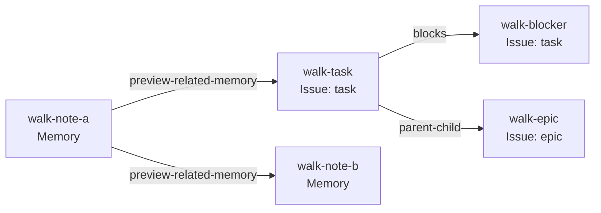

# Extending Beads: CLI updates and Preview 2

[Earlier this month](https://blog.gascity.com/posts/extending-beads-memories-versions-and-the-wire-protocol/), I introduced the work to extend Beads beyond Issues and Dependencies. Beads can hold different kinds of things, and Links can express different kinds of relationships between them. We are announcing Preview 2 this week, which has primarily focused on CLI cleanup and completeness. There were some happy paths in Preview 1, but it was VERY easy to get off the beaten path. With Preview 2, there is a wider happy path and some cleanup along the way.

While we've made progress on the underlying implementation, the vast majority of us experience Beads either through the `bd` CLI or by asking our agents to work with Beads for us.

We tried VERY hard to keep the existing CLI entry points working; compatibility is an important part of this work. For example, Memories now work with the common Bead commands, and the existing `remember`/`memories`/`recall`/`forget` commands still work. Similarly, we now support Links that are *not* bead-to-bead Dependencies. The supported `bd dep` forms remain available, and the generic Link commands (`bd link create`, for example) also work on Dependencies. The runbook records the preview limits for each command.

One other significant change in this preview is that we've *mostly* normalized how types work, both for existing Dependency Links and for new Links that don't fit the Dependency model. That is, `--type` now works as expected. The old `--bead-type` and `--link-type` flags are gone; long live `--type`. I say *mostly* because the CLI's Type selections and displayed records are not fully aligned yet. This will get cleaned up in the next preview.

It would be singularly awesome if you would [install the Preview 2 build](https://github.com/donnabox/beads/releases/tag/graph-preview2) and let us know about any gaps you find. The runbook has the list of known limitations; if you find an unknown one, please file an issue and we'll add it to the queue.

## Types

The examples below are adapted from the [Preview 2 runbook](https://github.com/donnabox/beads/blob/dce2c89b8cecb482038f8780f02eee55af578243/docs/preview2/RUNBOOK.md). They build on one another in a fresh graph workspace initialized as the runbook describes; some use `jq`. Use practice data you can recreate.

One of the foundational building blocks of Beads is the graph.

In the shipping product, the nodes are called **Issues**, and the edges are called **Dependencies**. Issues can be bugs, tasks, or features. Dependencies can be `blocks`, `parent-child`, and other kinds of relationships.

That model fits work tracking for people and agents. To add other capabilities, we need records that do not carry all the behavior of an Issue or Dependency.

[Chris's Memory proposal](https://github.com/gastownhall/beads/issues/5877) prompted the generalization you can try in this preview.

In the new generalized model, **Beads** are the nodes and **Links** are the edges connecting Beads. Issues are specific types of Beads; Dependencies are specific types of Links. The familiar Issue and Dependency choices remain available.

Run `bd types` to see the names accepted by `--type`. In a new Preview 2 workspace, here are the Bead and Link types you can use:

```text
Bead Types (14):
  preview-memory            Memory Preview
  task                      Task Issue
  bug                       Bug Issue
  feature                   Feature Issue
  chore                     Chore Issue
  epic                      Epic Issue
  decision                  Decision Issue
  spike                     Spike Issue
  story                     Story Issue
  milestone                 Milestone Issue
  message                   Message Issue
  molecule                  Molecule Issue
  gate                      Gate Issue
  event                     Event Issue

Link Types (22):
  preview-related-memory    Related Memory Preview
  example-cites             Example Cites
  example-follows           Example Follows
  blocks                    Blocking Dependency
  parent-child              Parent/Child Dependency
  conditional-blocks        Conditional Blocks Dependency
  waits-for                 Waits For Dependency
  related                   Related Dependency
  discovered-from           Discovered From Dependency
  replies-to                Replies To Dependency
  relates-to                Relates To Dependency
  duplicates                Duplicates Dependency
  supersedes                Supersedes Dependency
  authored-by               Authored By Dependency
  assigned-to               Assigned To Dependency
  approved-by               Approved By Dependency
  attests                   Attests Dependency
  tracks                    Tracks Dependency
  until                     Until Dependency
  caused-by                 Caused By Dependency
  validates                 Validates Dependency
  delegated-from            Delegated From Dependency
```

This preview has several new Bead and Link types that are placeholders:

* `preview-memory` is a placeholder type for a Memory Bead.
* `preview-related-memory` is a placeholder type for a relation between a Memory and a Bead of any type.
* `example-cites` and `example-follows` are example Link types for building graphs of memories.

If you omit `--type`, `bd create` makes a `task` Issue. The shorter `bd link SOURCE TARGET` makes a `blocks` Dependency when you omit `--type`; `bd link create SOURCE TARGET` requires an explicit type.

`bd create` and `bd link create` refuse an unrecognized `--type`. The choices displayed by `bd types` are fixed in this preview; users cannot register new graph Types here.

> **Compatibility note:** The published `bd` 1.0.5 accepts custom Dependency labels through both `bd dep add --type` and `bd link --type`. A Preview 2 graph workspace instead requires a built-in Dependency choice shown by `bd types` on both paths. An unrecognized choice is refused; users cannot register a new graph Type here.

## Beads

Beads and Links have much in common:

- Each has a unique ID. IDs can contain slashes, so you can organize them into paths.
- Each has properties checked against its Type. Beads and Links also have separate metadata. Dependency Link metadata cannot be set in this preview; `preview-related-memory` and the example Link Types support it.
- Each has saved versions that you can inspect and compare.

The common operations for Beads and Links follow two command paths: top-level `bd` commands for Beads, and `bd link` subcommands for Links. The full runbook records the limits for each command.

| Task | Beads | Links |
| --- | --- | --- |
| Create | `bd create` | `bd link create` |
| List | `bd list` | `bd link list` |
| Show one | `bd show` | `bd link show` |
| Update | `bd update` | `bd link update` |
| Delete | `bd delete` | `bd link delete` |
| List versions | `bd versions` | `bd link versions` |
| Compare versions | `bd compare` | `bd link compare` |
| Count | `bd count` (Issues) | `bd link count` |

For familiarity and convenience, the CLI also has narrower shortcuts:

| Shortcut | Closest general command | Difference |
| --- | --- | --- |
| `bd remember` | `bd create --type preview-memory` or `bd update` | `remember` takes the Memory body as a positional argument. |
| `bd recall` | `bd show` | `recall` prints the body rather than the full record. |
| `bd forget` | `bd delete --force` | `forget` deletes a Memory immediately. |
| `bd memories` | `bd list --type preview-memory` | `memories` also searches Memory titles and bodies. |
| `bd dep add` | `bd link create` | `dep add` accepts an Issue pair and a Dependency kind. |
| `bd dep remove` | `bd link delete --force` | `dep remove` selects a blocking Dependency by Issue pair; `link delete` selects a Link ID. |
| `bd history` | `bd versions` | Both list saved versions. |
| `bd new`, `bd q` | `bd create` | Short Issue creation forms. |

There is no `bd link query` subcommand in this preview. Do not try `bd link query ID`: `bd link` treats two positional arguments as a request to create a Dependency. Use `bd link list` to inspect Links.

Issue Beads have been part of the product from the beginning. A **Memory** holds reusable information. It has two properties: a string `title` and a Markdown `body`.

The next four examples create Memories about release policies. They show the general `create` form, shorter field flags, and the Memory-specific `remember` command.

### Creating Beads

Create the first Memory by supplying its Type-checked properties and separate metadata as JSON:

```sh
# Create a Memory with JSON properties and separate metadata.
bd create --type preview-memory --id policy-a \
  --properties '{"title":"Policy A","body":"Review *before* publishing."}' \
  --metadata '{"origin":"manual test"}'
```

Create the second with individual field flags:

```sh
# Create a second Memory with the title and body flags.
bd create --type preview-memory --id policy-b --title 'Policy B' --body 'Retain the review evidence.'
```

The positional argument can also supply the title:

```sh
# Create a Memory using the positional title.
bd create 'Policy C' --type preview-memory --id policy-c --body 'Review policy changes before release.'
```

Finally, `remember` chooses the Memory Type for you and takes the body as its positional argument:

```sh
# Create a Memory with the remember shortcut.
bd remember 'Keep the release checklist.' --id policy-d --title 'Policy D'
```

Create two task Issues alongside the Memories:

```sh
# Create a prerequisite and work that waits for it.
bd create 'Blocking prerequisite' --id blocker --type task
bd create 'Work waiting on prerequisite' --id blocked-work --type task
```

These use the general `bd create` form. `bd remember` is specific to Memories.

### Listing Beads

The general `list` command supports all Bead types, including Issues and Memories. With no filter, it lists both:

```sh
# List Beads as readable rows and as JSON records.
bd list
bd list --format records-json
```

Use `--type` to see one choice at a time:

```sh
# Filter the Bead list to task Issues, then Memories.
bd list --type task
bd list --type preview-memory
```

The Memory-specific `bd memories` command is a convenient alternative and can search Memory titles and bodies:

```sh
# List all Memories with the Memory-specific shortcut.
bd memories --all
```

> **Known limitation:** `bd list --json` shows Issues only. Use `--format records-json` when you want JSON for both Issues and Memories. On `bd list`, `--all` includes closed and pinned Issues and removes the default row limit within Preview 2's bounds; it does not add Links. Use `bd link list` for Links.

### Reading a Bead

`list` finds Beads that meet your criteria. Once you have an ID, `bd show` reads the full current record:

```sh
# Show a Memory and an Issue as complete graph records.
bd show policy-a --format graph-json
bd show blocker --format graph-json
```

The Memory-specific `recall` command displays only a Memory's body. It refuses an Issue ID:

```sh
# Read a Memory body.
bd recall policy-a

# Expected refusal: recall takes a Memory ID, not an Issue ID.
bd recall blocker
```

### Updating Beads

The properties and metadata of a Bead (or Link) are separate JSON objects. You can update either or both with `bd update`.

Three flags control property edits:

| Flag | Effect |
| --- | --- |
| `--properties '{...}'` | Change only the named properties; leave the others alone. |
| `--replace-properties '{...}'` | Replace all writable properties; include every required field. |
| `--patch '[...]'` | Apply an ordered JSON Patch-style list of `add`, `replace`, or `remove` operations. |

Here are these three forms in use:

```sh
# Merge, replace, and patch Memory properties in turn.
bd update policy-a --properties '{"body":"Review and qualify before publishing."}'
bd update policy-a --replace-properties '{"title":"Policy A","body":"Reviewed policy."}'
bd update policy-a --patch '[{"op":"replace","path":"/body","value":"Qualified policy."}]'
```

Metadata has similar merge and replacement options. You can also set or remove one key at a time:

| Flag | Effect |
| --- | --- |
| `--metadata '{...}'` | Merge the named keys, leaving other metadata alone. |
| `--replace-metadata '{...}'` | Replace the entire metadata object. |
| `--set-metadata KEY=VALUE` | Set one key to a typed JSON value. |
| `--unset-metadata KEY` | Remove one key. |

```sh
# Merge, set, unset, and replace Memory metadata in turn.
bd update policy-a --metadata '{"team":"docs"}'
bd update policy-a --set-metadata team=release
bd update policy-a --set-metadata reviewed=true
bd update policy-a --unset-metadata team
bd update policy-a --replace-metadata '{"origin":"manual test","reviewed":true}'
```

The general `bd update` forms work on any Bead type where the selected fields are writable. For a Memory, `bd remember --update ID` is a shortcut for changing its body or title. A positional argument changes the body; `--title` changes the title. You can supply either or both, and omitted fields stay unchanged:

```sh
# Update the Memory body and title with the remember shortcut.
bd remember 'Review before publishing and after any major change.' --update policy-a
bd remember --update policy-a --title 'Policy A, revised'
```

### Deleting Beads

`bd delete ID` previews the deletion without changing the Bead. Add `--force` to apply it. We delete `policy-c` and `policy-d` here; the next section builds a separate mixed graph.

```sh
# Preview a Bead deletion; policy-c remains present.
bd delete policy-c

# Apply the deletion with --force.
bd delete policy-c --force
```

The Memory-specific `bd forget` deletes immediately, like `bd delete --force`:

```sh
# Delete an unlinked Memory with the forget shortcut.
bd forget policy-d
```

### Versions and revisions

Like Git, Beads keeps earlier states so you can inspect how a record changed. Creating or changing a Bead or Link saves a version with an opaque **revision token**. A deletion retains earlier snapshots; it does not create a new live version.

Create a Memory, then change its title twice:

```sh
# Create a Memory, then save two more title versions.
bd create --id policy-e --properties '{ "title": "First" }' --type preview-memory
bd update policy-e --properties '{ "title": "Second" }'
bd update policy-e --properties '{ "title": "Third" }'
```

Those commands create three versions. List them, newest first:

```sh
# List the three saved versions of the Memory.
bd versions policy-e
```

Use a revision token to read an exact saved version with `bd show ID --version TOKEN`, or compare two versions with `bd compare ID --from TOKEN --to TOKEN`. For example:

```sh
# capture the current revision of policy-e
before_policy_revision="$(bd show policy-e --format graph-json | jq -er '.result.revision')"

# make one more change and capture its revision
bd update policy-e --set-metadata review=started
after_policy_revision="$(bd show policy-e --format graph-json | jq -er '.result.revision')"

# show both saved versions
bd show policy-e --version "$before_policy_revision" --format graph-json
bd show policy-e --version "$after_policy_revision" --format graph-json

# compare them
bd compare policy-e --from "$before_policy_revision" --to "$after_policy_revision" --json
```

Revisions also provide **optimistic concurrency control**. Think of Git's `--force-with-lease`: a change goes through only if the current state is still the one you saw. `bd update` and `bd delete` accept an optional `--if-revision TOKEN`. If another change advanced the record, your command is refused instead of overwriting it.

```sh
# Update policy-e only if its revision still matches the one we just read.
bd update policy-e --set-metadata review=complete --if-revision "$after_policy_revision"

# Expected refusals: these tokens are stale after the successful update.
bd update policy-e --set-metadata review=stale --if-revision "$after_policy_revision"
bd delete policy-e --force --if-revision "$before_policy_revision"
```

Read a fresh token before deleting `policy-e`. The earlier token is stale after the successful update:

```sh
# Read the new current revision after the successful update.
latest_policy_revision="$(bd show policy-e --format graph-json | jq -er '.result.revision')"

# Delete policy-e only if that revision still matches.
bd delete policy-e --force --if-revision "$latest_policy_revision"
```

## Links and graphs

The Bead operations you just tried have matching Link operations under `bd link`: create, list, show, update, delete, versions, and compare. A Link has its own stable ID, Type, properties, metadata, and saved versions. A Link connects a *source* Bead to a *target* Bead. Its `source` and `target` fields refer to those Beads.

This walkthrough uses `blocks` and `parent-child` for Issue relationships, and `preview-related-memory` for Memory-to-Memory and Memory-to-Issue relationships. The first two are Dependencies; the last is an informational Link.

### Creating Links and a mixed graph

Let's create a fresh group of Memory and Issue Beads in the same workspace. The explicit `--type` flags show which kind each Bead is:

```sh
# Create three Issues: work, its prerequisite, and its parent epic.
bd create 'Ship Preview 2' --id walk-task --type task
bd create 'Verify the CLI' --id walk-blocker --type task
bd create 'Preview 2 release' --id walk-epic --type epic

# Create two Memories, using the general and Memory-specific commands.
bd create 'Testing note' --id walk-note-a --type preview-memory --body 'Record a manual CLI pass.'
bd remember 'Keep the test evidence with the release.' --id walk-note-b --title 'Evidence note'
```

Connect the Issues, then the Memories, then a Memory to an Issue:

```sh
# walk-task waits for walk-blocker; this is a Dependency created with bd link.
bd link create walk-task walk-blocker --type blocks --id walk-blocks

# Make walk-task a child of walk-epic with the Dependency shortcut.
bd dep add walk-task walk-epic --type parent-child --id walk-parent

# Connect the two Memories with an informational Link.
bd link create walk-note-a walk-note-b --type preview-related-memory --id walk-related \
  --properties '{"note":"companion memory"}'

# Connect a Memory to an Issue; metadata is separate from properties.
bd link create walk-note-a walk-task --type preview-related-memory --id walk-context \
  --properties '{"note":"context for release"}' --metadata '{"source":"manual test"}'
```

The arrows below point from each Link's source to its target. In the `blocks` relationship, that means `walk-task` waits for `walk-blocker`. The `parent-child` arrow points from child to parent.



List or show Beads with top-level `bd` commands, and Links with `bd link` commands. The generic graph view can traverse both kinds of Bead and Link; plain `bd graph ISSUE` remains the Issue dependency view.

```sh
# List the Beads and Links in this workspace.
bd list
bd link list

# Narrow the Link list to those leaving walk-note-a.
bd link list --source walk-note-a
bd link count --source walk-note-a

# Read one Bead and one Link as graph records.
bd show walk-note-a --format graph-json
bd link show walk-context --format graph-json

# Traverse the mixed graph, then see the familiar Issue dependency view.
bd graph walk-note-a --view generic --direction out --depth 2 --json
bd graph walk-task
```

### Updating Links

`bd update` changes a Bead; `bd link update` changes an informational Link. Both support the property and metadata forms shown earlier. A Link's Type and endpoints cannot be edited. Native Dependency Links do not accept property or metadata updates in this preview.

```sh
# Save the Link revision so we can inspect this earlier version later.
before_context_revision="$(bd link show walk-context --format graph-json | jq -er '.result.revision')"

# Update a property, then set metadata without changing the Link's identity.
bd link update walk-context --properties '{"note":"reviewed context"}'
bd link update walk-context --set-metadata reviewed=true

# Read the updated Link.
bd link show walk-context --format graph-json
```

Informational Links can be updated in place while retaining their identity and earlier states. Native Dependency Links still refuse property and metadata edits in this preview.

> **Compatibility note:** A graph Link has a unique ID independent of its source and target. Ordinary Dependencies are identified by the source/target pair, with at most one Dependency between two specific Issues. That one-per-ordered-pair restriction still applies to Dependency Links in this preview; independent Link IDs do not remove it.

### Deleting Links and Beads

Graph deletion does not cascade. A Bead with any live incident Link cannot be deleted; remove the Link first. Deleting a Link does not delete either endpoint Bead.

```sh
# Expected refusal: walk-note-b still has an incoming Link.
bd delete walk-note-b --force

# Preview, then delete that Link.
bd link delete walk-related
bd link delete walk-related --force

# Preview, then delete the now-unlinked Memory.
bd delete walk-note-b
bd delete walk-note-b --force
```

### Link versions and revision guards

Link versions work like Bead versions. The earlier `walk-context` revision remains readable after the update, and a stale revision guard refuses a new write.

```sh
# List Link versions and capture its current revision.
bd link versions walk-context --json
after_context_revision="$(bd link show walk-context --format graph-json | jq -er '.result.revision')"

# Read the earlier version and compare it with the current one.
bd link show walk-context --version "$before_context_revision" --format graph-json
bd link compare walk-context --from "$before_context_revision" --to "$after_context_revision" --json

# Expected refusal: this revision was current before the Link edits.
bd link update walk-context --set-metadata audit=stale --if-revision "$before_context_revision"

# The current revision allows one more edit.
bd link update walk-context --set-metadata audit=checked --if-revision "$after_context_revision"

# A deleted Link also retains its earlier citable versions.
bd link versions walk-related --json
```

### Preview boundaries

**Preview 2 is experimental: data in a preview workspace may be lost, and preview-to-preview compatibility is not supported. There is currently no supported way to upgrade a workspace from one preview to the next. Use data you can recreate, and do not rely on this preview as your only copy of important work.** Start each preview in a new workspace.

Run `bd types` for usable CLI choices. Installing or editing graph Type descriptors is unavailable in this preview. Other unfinished areas include:

- Import and export for migration, plus general backup and recovery.
- HTTP writes and BDP History. The BDP service provides Read only.

A stale revision or invalid Type causes a refusal. After an expected refusal, check that no data changed before continuing. This preview focuses on Issues, Memories, Links, Dependencies, and the commands used with them. Other Beads commands may refuse.

## Where Are We

Preview 2 contains a lot of CLI changes and underlying infrastructure work. We are driving toward the requirements set out in [Chris's Memory proposal](https://github.com/gastownhall/beads/issues/5877) and have made steady progress.

Some major areas still need more work:

- Fleshing out how to define and register new Bead and Link types. Preview 2 provides a fixed catalog; users cannot register new graph Types yet.
- Implementing the full provenance capabilities outlined in the Memory proposal. Recorded change attribution is available, but the complete provenance surface is unfinished.
- Implementing the rest of BDP to support the federation requirements outlined in Chris's proposal. The preview provides BDP Read; HTTP writes, BDP History, and cross-Scope Links remain unavailable.
- Ensuring that the entire Bead, Link, Issue, and Dependency surface works consistently.
- Ensuring that the remaining operational parts of the CLI work with and respect the new features and capabilities we are introducing.

Work on these areas is underway, but the full capabilities aren't ready for prime time. If your curiosity has you spelunking in those areas, prepare to be surprised in Preview 3.

Once again, try the workflow on a small project and tell us where it helps or gets in your way. Join the conversation in the [Gas Town Hall Discord](https://discord.gg/xHpUGUzZp2), in the `#beads` and `#memory-beads` channels, or [file a Beads issue](https://github.com/gastownhall/beads/issues) with a `[Memory]` prefix. Feedback on the protocol itself can go straight to the [BDP repo](https://github.com/gastownhall/bdp/issues). Include the integration commit you tried so we can reproduce what you saw.
