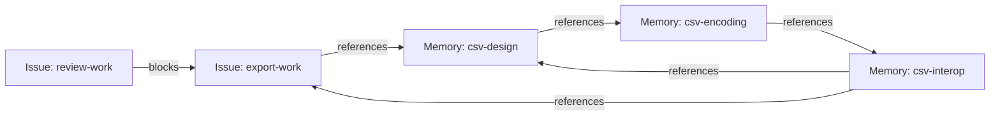
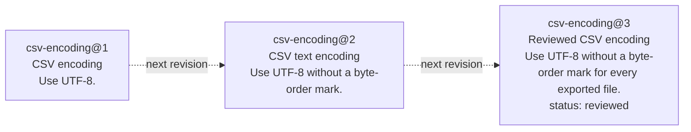
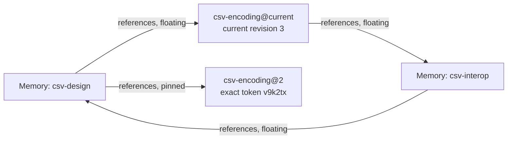
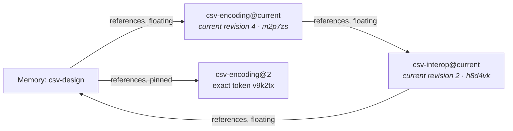

# Working with Tasks and Memories with Preview 3, Part 1

We just pushed [Memory Beads Preview 3](https://github.com/donnabox/beads/releases/tag/graph-preview3) out the door. This work is in response to the [Memory Beads proposal](https://github.com/gastownhall/beads/issues/5877) and represents progress towards the three big things we are building:

1. A generic graph structure that can span issue and non-issue beads. This mode is enabled by passing `--graph-mode link` to `bd init`, which creates a non-production-ready workspace that enables the new features.
2. A set of bead and link types that model how memories will work with/as beads.
3. An implementation of a protocol (BDP) designed to allow bead consumers and producers to interoperate and build graphs that span the scope of a single implementation.


The first preview was there primarily to demonstrate a happy path through these three areas. The good news is, it all worked. The meh news is that the happy path was pretty narrow. Preview 2 added no new features; it just made the happy path wider, as does Preview 3. The Preview 3 bits have a lot of undone work that will take weeks and a few previews to grind out. But, Preview 3 has two *very* significant features:

1. Support for importing data from previous versions of beads. You can now export your data from an existing 1.3.* workspace and import it into a new `--graph-mode link` workspace.
2. The first draft of the Bead and Link Types that model how memory will work in beads, along with a memory-specific CLI surface (`bd memory`) for working with these types.

You can now seed a fresh `--graph-mode link` workspace with a copy of your existing Issues, dependencies and memories. Preview 3 is not ready for production work; the [runbook](https://github.com/donnabox/beads/blob/06ce84c3122d553d9ca2ef7878235bd38b09f4d0/preview3/RUNBOOK.md) has the complete export/import walkthrough for trying this on a disposable copy.

<!-- Editorial Part 1; original prose retained wherever possible, CLI equivalence demonstrations and repeated displays removed. Derived from preview3-blog.md snapshot 96782730f1e33480c96bf902eb4c24014da5eaba665ce28016f79e567fd03ca7 on October 26, 2026. Examples remain illustrative; the original b27 transcript attribution is historical. Release links now point to the official source-only graph-preview3 release; the published runbook is frozen at 06ce84c3122d553d9ca2ef7878235bd38b09f4d0. These split drafts are independent editorial copies, not verbatim-sync sources for the spec or runbook. -->

## Introducing Memory Beads

This release is the first one containing intentionally designed bead types; Preview 2 had placeholder typenames (`preview-memory`, `preview-references`) that have now been replaced with types we believe capture the common scenarios (and satisfy the requirements and scenarios laid out in [the Memory Beads proposal](https://github.com/gastownhall/beads/issues/5877)). The rest of this blog is a walk through of the new bead types.


The [Memory Type
spec](https://github.com/gastownhall/bdp/blob/94f699b947382e3a52385b1895a941575fcc08cb/specs/types/memory/memory.md#overview-informative)
introduces the model for Memory Beads in great detail. Here we describe the new
CLI surface for memory (`bd memory`) by walking through one small example: adding CSV
export to a product, keeping the design notes, and recording the rules the
feature must follow.

The installed Bead Type names used here include `memory`, `task` and `bug`;
Link Type names include `references`, `superseded-by` and `blocks`. The `issue`
and `dependency` Types are abstract, so creation selects a concrete refinement
such as `task`, `bug` or `blocks`.

The transcripts below show illustrative, abbreviated output; administrative
fields are omitted. Each example has a comment, a command prefixed with `>`,
and its output.

### Creating Memories

Memory Beads record knowledge for later use by both humans and agents. Memory beads can represent policies, requirements, decisions, or generic information that doesn't fit into a particular category. Plain Memory beads are informative; Constraint Beads (covered in part 2 of this post) are Memory Beads that add normative rules while retaining their "memory-ness."

All Memory Beads have a `title` and a Markdown `body`; their third property (`status`) is optional. Unlike Issues, where status defines a lifecycle specific to work tracking, the `status` field on Memory Beads is free-form text and can map onto whatever lifecycle you, your project, or your organization uses (e.g., PROPOSED or APPROVED).

Four common commands work with Memory Beads:

- `bd memory remember [BODY] [--key ID | --update REF]` creates a Memory or edits an existing one.
- `bd memory recall REF` reads a Memory's Markdown body.
- `bd memory memories [SEARCH]` browses compact Memory summaries, optionally matching search text.
- `bd memory forget REF` deletes a Memory.

The familiar `bd remember`, `bd recall`, `bd memories` and `bd forget` spellings remain aliases for these four commands. Memories work with the same general Bead commands too; the runbook and CLI spec cover those spellings.

For the CSV feature in this walkthrough, we will start with a design note, an encoding
note and a note about spreadsheet interoperability. `bd memory remember` takes
the body as its argument. We use  `--key`
to choose the identity and `--title` to choose the display text.

```console
# Record the initial design under an explicit ID and title.
> bd memory remember 'Export the selected rows as CSV.' \
  --key csv-design --title 'CSV export design' --create-only
Created csv-design [memory] "CSV export design"

# Record the text-encoding note that the design will refer to.
> bd memory remember 'Use UTF-8.' \
  --key csv-encoding --title 'CSV encoding' --create-only
Created csv-encoding [memory] "CSV encoding"

# Record the spreadsheet checks that connect the design to implementation work.
> bd memory remember 'Test the exported UTF-8 file in spreadsheet tools; keep the results with the implementation work.' \
  --key csv-interop --title 'CSV interoperability checks' --create-only
Created csv-interop [memory] "CSV interoperability checks"

```

The example also has two Issues of Type `task`: `export-work` implements the feature, and `review-work` reviews it. Review waits for implementation through a `blocks` Dependency. The Issues record the work, while the notes hold knowledge that helps people carry it out.

Memory and Issue Beads work with the general Bead commands. We have created
three Memories and two Issues; use `bd list` to see them together in the mixed
inventory.

```console
# List Memory and Issue Beads together in the current Scope.
> bd list --type any
csv-design      [memory]  CSV export design
csv-encoding    [memory]  CSV encoding
csv-interop     [memory]  CSV interoperability checks
export-work     [task]  Add CSV export
review-work     [task]  Review CSV export

```

To see only Memories or tasks, filter the inventory with `--type`. The
memory-specific `bd memory memories` command, also available as `bd memories`,
provides compact Memory summaries rather than the general inventory's full
Resource formats and paging.

`bd memory recall` writes just a Memory's Markdown body.

```console
# Read only the design note's body through the Memory command group.
> bd memory recall csv-design
Export the selected rows as CSV.

```

The `remember` command supports both creating a new Memory and updating an existing one by using the same key. If, however, the Bead ID passed to the `remember` command is misspelled, we wind up with an errant second Bead and the intended Memory is not updated. To protect against this situation, the `remember` command accepts two mutually exclusive flags:

- `--update ID` — only update the Memory if the ID exists; fail otherwise.
- `--create-only` — only create a new Memory; fail if the supplied `--key` or `--id` already exists.

Use `--update` when you intend to edit an existing Memory. Omitted content stays unchanged, so this call changes the design's body while preserving its title.

```console
# Clarify the existing design without risking a second Memory.
> bd memory remember --update csv-design \
  --body 'Export the selected rows as CSV, including column headings.'
Updated csv-design [memory] "CSV export design"

```

### Linking Memories

References Links connect memory beads so that readers can follow useful related context.  There is a distinct new link type, `references`, that connects memory beads to one another or to beads of any type (e.g., `task`). Reference links share the same three properties as memory beads (title, body, status) allowing you to treat references between memories as full-fledged parts of the memory graph; unlike memory beads however, all three of these fields are optional. Reference links can be created using the memory-specific `bd memory reference` command or the generic `bd link create` command that works with all link types.

Three commands create and follow References Links:

- `bd memory reference SOURCE TARGET` creates a References Link from the source to the target.
- `bd memory references REF... [--depth N]` follows outgoing References Links to find related context.
- `bd memory referenced-by REF... [--depth N]` follows incoming References Links to find Beads that refer to the selected Beads.

In our example, the design uses the encoding note, which points to the interoperability checks;
those checks refer back to the design. The checks also point to the
implementation Issue, which refers to the design it implements. These
connections form one cycle entirely among Memories and another through an
Issue. A title or body on a Link can explain why the connection matters. The full setup is in the runbook; these two calls show the References creation pattern.

```console
# Explain which encoding note the design uses.
> bd memory reference csv-design csv-encoding --id encoding-context \
  --title 'Uses this encoding' --body 'Text encoding for exported files'
Created encoding-context: csv-design --references--> csv-encoding

# Connect the encoding choice to its spreadsheet checks.
> bd memory reference csv-encoding csv-interop --id encoding-checks \
  --title 'Interoperability checks for this encoding'
Created encoding-checks: csv-encoding --references--> csv-interop

```

The three notes form a permitted References cycle. A second cycle follows the
same encoding and interoperability notes through the implementation Issue and
back to the design. The `blocks` Dependency separately says that review waits
for implementation; References supply context without imposing that workflow.




The `bd memory references` and `bd memory referenced-by` commands follow these connections in either direction. `--depth` controls how far to go, and repeated visits are detected so a cycle cannot send the traversal around forever.

```console
# Follow References farther to include both cycles.
> bd memory references csv-design --depth 4
csv-design [memory] CSV export design
└─ references → csv-encoding [memory] CSV encoding
   └─ references → csv-interop [memory] CSV interoperability checks
      ├─ references → csv-design (cycle)
      └─ references → export-work [task] Add CSV export
         └─ references → csv-design (cycle)

```

### Memories Over Time

There are two ways for memory to evolve over time. The simplest way is simply by updating the memory in place. Its id/key stays the same, it just takes on new values. If you are simply changing the specifics of a given memory but it plays the same role as it did before, this is likely the way to go.

Sometimes however, fundamentally new memories need to be created that effectively replace one or more memories. In this case, agents or humans who reference the memory that's been retired need the ability to know which replacement is in effect.

Both of these scenarios are supported. Let's look at the first one first.


#### Revising a Memory

A revision identifies an immutable saved state of a Bead. An update that changes
its state records a new revision; the id/key stays constant while the state it
references evolves. Deleting a Bead does not rewrite its earlier states. Most
read commands let you select the current state or, using `@` syntax, a specific
retained revision from the past.

To see revisions in action, let's update the encoding note twice, changing its title and body each time and marking the final state reviewed. Both edits keep the ID `csv-encoding`. An unchanged update
leaves the revision unchanged. `bd versions` lists the saved states so that a
reader can select one explicitly.

```console
# Clarify the encoding requirement while keeping the same note.
> bd memory remember --update csv-encoding --title 'CSV text encoding' \
  --body 'Use UTF-8 without a byte-order mark.'
Updated csv-encoding; revision v9k2tx.

# Refine the title and body again and label the note reviewed.
> bd memory remember --update csv-encoding --title 'Reviewed CSV encoding' \
  --body 'Use UTF-8 without a byte-order mark for every exported file.' \
  --status reviewed
Updated csv-encoding; revision c6r8wn.

# List the revisions saved for this identity.
> bd versions csv-encoding
SEQ  REVISION  TITLE
1    m7q4pf    CSV encoding
2    v9k2tx    CSV text encoding
3    c6r8wn    Reviewed CSV encoding

```

`SEQ` is the store-local revision number; `REVISION` is the exact stable token
for the same revision. Use the number when browsing that identity's history in
the same store. Use the complete exact token when sharing a saved revision,
recording it in another system or retaining a reference across export and import.
Local numbers are not portable: another store may assign a different number to
the same revision, and equal numbers on different Beads do not identify the same
state.

The short, random-looking tokens in
these illustrations are invented; actual tokens are opaque and may be much
longer. Use the complete token returned by the store when making an exact
reference.

All three revisions share the same id/key (`csv-encoding`). When specifying a bead or link's ID on the command line, you can append `@2` to select
local revision number 2, or `@=v9k2tx` to select that revision by its exact
token. These are *pinned* references. Omitting the suffix produces an unpinned
or *floating* reference, which selects the latest state when used.

The diagram shows three saved states of one identity,
with dotted arrows indicating revision history rather than stored Links.




Here is an example showing unpinned/floating references as well as pinned references using `@` and `@=` to point to a specific revision.

```console
# Read the current encoding note.
> bd memory recall csv-encoding
Use UTF-8 without a byte-order mark for every exported file.

# Recall just the body of that saved revision.
> bd memory recall csv-encoding@2
Use UTF-8 without a byte-order mark.

```

An unpinned Reference follows the current revision of its target. A pin selects
one exact saved revision, which is useful when recording the version a design
relied on. Add another References Link to revision 2, keeping the original
floating Link alongside it.

```console
# Record the exact encoding revision used by the design.
> bd memory reference csv-design csv-encoding@2 --id encoding-used \
  --title 'Encoding revision used for the design'
Created encoding-used: csv-design --references--> csv-encoding@2

```

Both Links identify the same encoding Bead. The diagram separates its current
and saved representations to make their different revision selections visible.



The pinned Link keeps its exact target token through later edits to the note.

Now update both notes reached through the floating References: the encoding
note and its interoperability checks. Their identities and the Links stay the
same, while subsequent floating reads see the updated content. The pinned
Reference still selects encoding revision 2.

```console
# Refine the encoding note again without replacing its identity.
> bd memory remember --update csv-encoding \
  --body 'Use UTF-8 without a byte-order mark, with CRLF line endings.'
Updated csv-encoding; revision m2p7zs.

# Extend the checks behind the next floating Reference.
> bd memory remember --update csv-interop \
  --body 'Test UTF-8 and CRLF line endings in spreadsheet tools; record the results with the implementation work.'
Updated csv-interop; revision h8d4vk.

```

The same graph now follows revision 4 of the encoding note and revision 2 of the
interoperability checks through its floating References. The pinned Link still
selects encoding revision 2; the changed revision labels are italicized.



The Memory update shorthand accepts `--title`, `--body` and `--status` while
preserving omitted content. Use `bd update` for the full property-edit surface
or a Type change.

#### Retiring a Memory using `superseded-by` links

Revisions allow a memory to evolve in place. Floating references pick up the latest state in that evolution; pinned references freeze at a moment in time. Because very few users of a bead are going to meticulously look through its revisions, it's difficult to know whether that evolution reflected refinement of the same fact, statement, or idea, or a direct contradiction. To make replacement obvious and discoverable, use the `superseded-by` link type to indicate that the source bead is being retired and the target bead holds the updated memory. Revisions over time of a given bead assume refinement; traversing beads through `superseded-by` assumes replacement.

Three commands create and follow Superseded By Links:

- `bd memory supersede OLD NEW` creates a Superseded By Link from a retiring Memory to its replacement.
- `bd memory successor REF... [--depth N]` follows the replacement chain forward from each retiring Memory.
- `bd memory supersedes REF... [--depth N]` follows the chain backward from a replacement, showing its direct predecessors by default.

For example, a short encoding note may eventually give way to a guide covering headings,
spreadsheet behavior and examples. Create the guide as a separately maintained
Memory. A Superseded By Link records that it replaces the old note. The old
identity and its earlier revisions remain readable.

```console
# Create the separately maintained replacement guide.
> bd memory remember 'Encoding, headings and spreadsheet examples.' \
  --key csv-guide --title 'CSV interoperability guide' --create-only
Created csv-guide [memory] "CSV interoperability guide"

# Record the old-to-new replacement.
> bd memory supersede csv-encoding csv-guide --id encoding-replacement
Created encoding-replacement: csv-encoding --superseded-by--> csv-guide

```

The replacement Link points from old to new and directs readers to the
successor for current guidance. This succession is normative: continuing to
follow the replaced guidance can conflict with that direction. This view shows
the Link beside the original forward Reference; the other References remain
unchanged.


Each retiring Memory has at most one successor, and replacement chains cannot
cycle. This read follows the replacement relationship forward.

```console
# Follow the encoding note's replacement path.
> bd memory successor csv-encoding
csv-encoding [memory] Reviewed CSV encoding
└─ superseded-by → csv-guide [memory] CSV interoperability guide

```


## Where Are We

Preview 3 is the first preview that really shows the directional shape we are creating to satisfy the requirements set out in [the original Memory Beads proposal](https://github.com/gastownhall/beads/issues/5877).

This post walked through the most fundamental types: `memory`, `references` and `superseded-by`. The next installment will turn to the rules that govern work.

As stated at the beginning of this post, some major areas still need more work:

- Incorporating feedback on the previews, specifically the new memory bead/link types.
- Implementing the full provenance capabilities outlined in the Memory proposal. Recorded change attribution is available, but the complete provenance surface is unfinished.
- Implementing the rest of BDP to support the federation requirements outlined in Chris's proposal. The qualified preview surface covers BDP Read; HTTP writes, BDP History, and cross-Scope Links remain outside that surface.
- Ensuring that the entire Bead, Link, Issue, and Dependency surface works consistently.
- Ensuring that the remaining operational parts of the CLI work with and respect the new features and capabilities we are introducing.

Work on these areas is underway, but the full capabilities aren't ready for prime time. If your curiosity has you spelunking in those areas, prepare to be surprised in future previews.

Get the [Preview 3 source build](https://github.com/donnabox/beads/releases/tag/graph-preview3). Once again, try the workflow on a small disposable copy of a project and tell us where it helps or gets in your way. Join the conversation in the [Gas Town Hall Discord](https://discord.gg/xHpUGUzZp2), in the `#beads` and `#memory-beads` channels, or [file a Beads issue](https://github.com/gastownhall/beads/issues) with a `[Memory]` prefix. Feedback on the protocol itself can go straight to the [BDP repo](https://github.com/gastownhall/bdp/issues). Include the integration commit you tried so we can reproduce what you saw.

[Memory Beads proposal]: https://github.com/gastownhall/beads/issues/5877
