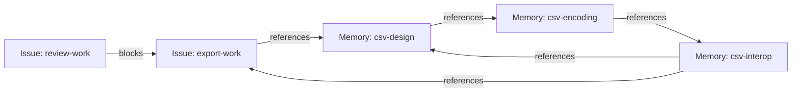
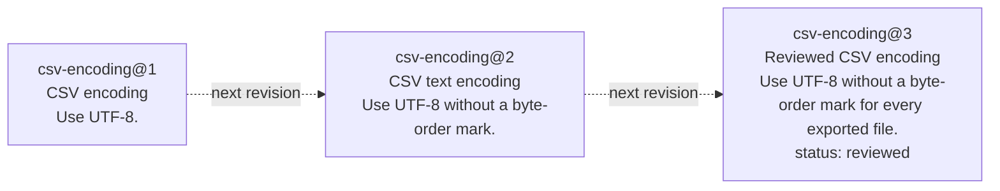
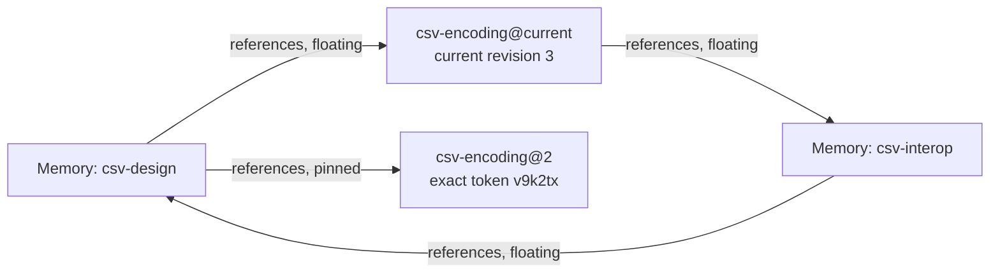
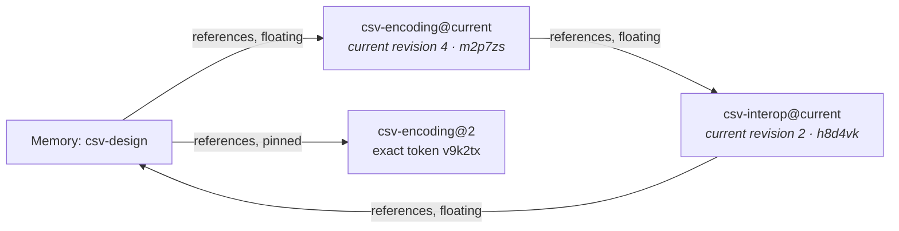

# Working with Tasks and Memories with Preview 3, Part 1

We just pushed [Memory Beads Preview 3](https://github.com/donnabox/beads/tree/preview3-acceptance-210f8da) out the door. The first preview was there primarily to demonstrate a happy path through the three big things we are building:

1. A generic graph structure that can span issue and non-issue beads. This mode is enabled by passing `--graph-mode link` to `bd init`, which creates a non-production-ready workspace that enables the new features.
2. A set of bead and link types that model how memories will work with/as beads.
3. An implementation of a protocol (BDP) designed to allow bead consumers and producers to interoperate and build graphs that span the scope of a single implementation.

The good news is, it all worked. The meh news is that the happy path was pretty narrow. Preview 2 added no new features; it just made the happy path wider, as does Preview 3. The Preview 3 bits have a lot of undone work that will take weeks and a few previews to grind out. But, Preview 3 has two *very* significant features:

1. Support for importing data from previous versions of beads. You can now export your data from an existing 1.3.* workspace and import it into a new `--graph-mode link` workspace.
2. The first draft of the Bead and Link Types that model how memory will work in beads, along with a memory-specific CLI surface (`bd memory`) for working with these types.

<!-- Donna: replace these two provisional import/export sentences and add the public runbook link. -->
You can now seed a fresh `--graph-mode link` workspace with a copy of your existing Issues, dependencies and memories. Preview 3 is not ready for production work; the runbook has the complete export/import walkthrough for trying this on a disposable copy.

<!-- Verbatim Part 1 split; Memory body preserved exactly apart from removal of administrative comments. Derived from preview3-blog.md snapshot 96782730f1e33480c96bf902eb4c24014da5eaba665ce28016f79e567fd03ca7 on October 26, 2026. Examples remain illustrative; the original b27 transcript attribution is historical. The acceptance-build link selects source, not a binary installer or release signoff. These split drafts are independent editorial copies, not verbatim-sync sources for the spec or runbook. -->

## Introducing Memory Beads

This release is the first one containing intentionally designed bead types; Preview 2 had placeholder typenames (`preview-memory`, `preview-references`) that have now been replaced with types we beleive capture the common scenarios (and satisfy the requirements and scenarios laid out in [the Memory Beads proposal](https://github.com/gastownhall/beads/issues/5877)). The rest of this blog is a walk through of the new bead types.


## Using Memory Beads and Links (informative)

The [Memory Type
spec](https://github.com/gastownhall/bdp/blob/94f699b947382e3a52385b1895a941575fcc08cb/specs/types/memory/memory.md#overview-informative)
introduces the model for Memory Beads in great detail. Here we describe the new
CLI surface for memory (`bd memory`) by walking through one small example: adding CSV
export to a product, keeping the design notes, and recording the rules the
feature must follow.

The installed Bead Type names used here include `memory`, `task` and `bug`;
Link Type names include `references`, `superseded-by` and `blocks`. The `issue`
and `dependency` Types are abstract, so creation selects a concrete refinement
such as `task`, `bug` or `blocks`.

The transcripts below show illustrative, abbreviated output; administrative
fields are omitted. Each example has a comment, a command prefixed with `>`,
and its output. Blocks described as alternatives demonstrate different ways
to perform the same operation.

### Creating Memories

Memory Beads record knowledge for later use by both humans and agents. Memory beads can represent policies, requirements, decisions, or generic information that doesn't fit into a particular category. Plain Memory beads are informative; Constraint Beads are Memory Beads that add normative rules while retaining their "memory-ness."

All Memory Beads have a `title` and a Markdown `body`; their third property (`status`) is optional. Unlike Issues, where status defines a lifecycle specific to work tracking, the `status` field on Memory Beads is free-form text and can map onto whatever lifecycle you, your project, or your organization uses (e.g., PROPOSED or APPROVED).

Four common commands work with Memory Beads:

- `bd memory remember [BODY] [--key ID | --update REF]` creates a Memory or edits an existing one.
- `bd memory recall REF` reads a Memory's Markdown body.
- `bd memory memories [SEARCH]` browses compact Memory summaries, optionally matching search text.
- `bd memory forget REF` deletes a Memory.

As we will see, `bd memory` has other commands that are specific to different kinds of memory. The current top-level `bd remember` et al are simply aliases to the corresponding `bd memory` version.

For the CSV feature in this walkthrough, we will start with a design note, an encoding
note and a note about spreadsheet interoperability. `bd memory remember` takes
the body as its argument. We use  `--key`
to choose the identity and `--title` to choose the display text.

```console
# Record the initial design under an explicit ID and title.
> bd memory remember 'Export the selected rows as CSV.' \
  --key csv-design --title 'CSV export design' --create-only
Created csv-design [memory] "CSV export design"

# Record the text-encoding note that the design will refer to.
> bd memory remember 'Use UTF-8.' \
  --key csv-encoding --title 'CSV encoding' --create-only
Created csv-encoding [memory] "CSV encoding"

# Record the spreadsheet checks that connect the design to implementation work.
> bd memory remember 'Test the exported UTF-8 file in spreadsheet tools; keep the results with the implementation work.' \
  --key csv-interop --title 'CSV interoperability checks' --create-only
Created csv-interop [memory] "CSV interoperability checks"

```

The top-level `bd remember` command remains a compatibility alias for `bd memory
remember`. Because Memories are Beads, the general `bd create` can create the
same notes by naming the `memory` Type explicitly. The three spellings below
are alternatives to the first creation above; you can pick a spelling when creating
the design note.

```console
# Create the design note using the top-level compatibility alias.
> bd remember 'Export the selected rows as CSV.' \
  --key csv-design --title 'CSV export design'
Created csv-design [memory] "CSV export design"

# Alternatively, create the same note using the Memory command group.
> bd memory remember 'Export the selected rows as CSV.' \
  --key csv-design --title 'CSV export design'
Created csv-design [memory] "CSV export design"

# Alternatively, create the same note using the general Bead command.
> bd create --id csv-design --type memory \
  --properties '{"title":"CSV export design","body":"Export the selected rows as CSV."}'
Created csv-design [memory] "CSV export design"

```

To finish out our scenario, let's create two Issues using the concrete `task` Type for implementing and reviewing the
feature. The Issues record the work, while the notes hold knowledge that helps
people carry it out. Issues use `description` for their text, while Memories
use `body`.
```console
# Create the implementation Issue.
> bd create --id export-work --type task \
  --properties '{"title":"Add CSV export","description":"Implement CSV export for the selected rows."}'
Created export-work [task] "Add CSV export"

# Create the review Issue.
> bd create --id review-work --type task \
  --properties '{"title":"Review CSV export","description":"Review the completed CSV export feature."}'
Created review-work [task] "Review CSV export"

```

Memory and Issue Beads work with the general Bead commands. We have created
three Memories and two Issues; use `bd list` to see them together in the mixed
inventory.

```console
# List Memory and Issue Beads together in the current Scope.
> bd list --type any
csv-design      [memory]  CSV export design
csv-encoding    [memory]  CSV encoding
csv-interop     [memory]  CSV interoperability checks
export-work     [task]  Add CSV export
review-work     [task]  Review CSV export

```

To see only Memories or tasks, filter the inventory with `--type`. The
memory-specific `bd memory memories` command, also available as `bd memories`,
provides compact Memory summaries rather than the general inventory's full
Resource formats and paging.

```console
# List the task Type family through the same general command.
> bd list --type task
export-work     [task]  Add CSV export
review-work     [task]  Review CSV export

# List the Memory Type family through the general Bead command.
> bd list --type memory
csv-design      [memory]  CSV export design
csv-encoding    [memory]  CSV encoding
csv-interop     [memory]  CSV interoperability checks

# Browse summaries through the top-level compatibility alias.
> bd memories
csv-design      [memory]  CSV export design
csv-encoding    [memory]  CSV encoding
csv-interop     [memory]  CSV interoperability checks

# Browse the same summaries through the Memory command group.
> bd memory memories
csv-design      [memory]  CSV export design
csv-encoding    [memory]  CSV encoding
csv-interop     [memory]  CSV interoperability checks

```

Likewise, inspect a Memory with the generic `bd show` command or the
memory-specific `bd memory recall`, also available as `bd recall`. The former
shows the Bead document, including its properties; the latter writes only its
Markdown body.

```console
# Inspect the design note as a Bead document.
> bd show csv-design --output-format json
{
  "id": "csv-design",
  "type": "memory",
  "properties": {
    "title": "CSV export design",
    "body": "Export the selected rows as CSV."
  }
}

# Read only the design note's body through the Memory command group.
> bd memory recall csv-design
Export the selected rows as CSV.

# Read the same body through the top-level compatibility alias.
> bd recall csv-design
Export the selected rows as CSV.

```

Finally, delete a Memory with the general `bd delete` command or the
memory-specific `bd memory forget`, also available as `bd forget`. Create a
separate temporary note so the deletion example leaves the CSV notes available
for the rest of the walkthrough.

After creating the temporary note, choose one of the deletion commands below.
The deletion commands are alternatives. On the
general command, `--force` supplies the intent to apply the deletion, while
`forget` already expresses that intent.

```console
# Create a temporary Memory for the deletion examples.
> bd memory remember 'Temporary note for comparing deletion commands.' \
  --key deletion-demo
Created deletion-demo [memory]

# Delete the temporary Memory through the Memory command group.
> bd memory forget deletion-demo
Deleted deletion-demo.

# Alternatively, delete it through the top-level compatibility alias.
> bd forget deletion-demo
Deleted deletion-demo.

# Alternatively, apply the same deletion through the general Bead command.
> bd delete deletion-demo --force
Deleted deletion-demo.

```

These conveniences work with the same Beads as the general commands, with
Memory-specific defaults and rendering. The mapping for `bd update` is
different: `remember` supports both creating a new Memory and updating an
existing one by using the same key. On a new throwaway identity, these two
calls first create a note and then change its body, preserving its title.

```console
# Create a reminder under a new identity.
> bd memory remember 'Include column headings in CSV exports.' \
  --key remember-demo --title 'CSV headings reminder'
Created remember-demo [memory] "CSV headings reminder"

# Update that same Memory, leaving its title unchanged.
> bd memory remember 'Include headings even when no rows are selected.' \
  --key remember-demo
Updated remember-demo [memory] "CSV headings reminder"

```

The following general commands are an alternative way to perform those two
operations. Choose either this block or the preceding one for the new
`remember-demo` identity.

```console
# Create the same reminder through the general Bead command.
> bd create --id remember-demo --type memory \
  --properties '{"title":"CSV headings reminder","body":"Include column headings in CSV exports."}'
Created remember-demo [memory] "CSV headings reminder"

# Apply the same body change through the general update command.
> bd update remember-demo \
  --set-property body='Include headings even when no rows are selected.'
Updated remember-demo [memory] "CSV headings reminder"

```

After either block, the identity already exists. If, however, the Bead ID passed to the `remember` command is misspelled, we wind up with an errant second Bead and the intended Memory is not updated. To protect against this situation, the `remember` command accepts two mutually exclusive flags:

- `--update ID` — only update the Memory if the ID exists; fail otherwise.
- `--create-only` — only create a new Memory; fail if the supplied `--key` or `--id` already exists.

Use `--update` when you intend to edit an existing Memory. The first call below updates the reminder; the second misspells its ID and fails without creating another Bead. The final call uses `--create-only` to protect the existing reminder from an attempted creation.

```console
# Update the existing reminder while preserving its title.
> bd memory remember 'Keep headings even when the selection is empty.' \
  --update remember-demo
Updated remember-demo [memory] "CSV headings reminder"

# Refuse an update to a misspelled ID rather than creating another Memory.
> bd memory remember 'This text must not create another Memory.' \
  --update remembre-demo
Error: remembre-demo not found.

# Refuse to create another Memory at an identity already used above.
> bd memory remember 'This text must not replace the saved reminder.' \
  --key remember-demo --title 'A competing reminder' --create-only
Error: remember-demo already exists; --create-only refused the write.

```

### Linking Memories

References Links connect memory beads so that readers can follow useful related context.  There is a distinct new link type, `references`, that connects memory beads to one another or to beads of any type (e.g., `task`). Reference links share the same three properties as memory beads (title, body, status) allowing you to treat references between memories as full-fledged parts of the memory graph; unlike memory beads however, all three of these fields are optional. Reference links can be created using the memory-specific `bd memory reference` command or the generic `bd link create` command that works with all link types.

Generic References links provide informative context. The Requires, Defines, and Subject To Link Types are specializations that build normative rules that activities and artifacts have to adhere to; these specialized
Links are also References. Superseded By expresses normative succession: it
directs readers to the successor for current guidance. It does not automatically
approve that successor, change status, rewrite Subject To declarations or erase
history.

Three commands create and follow References Links:

- `bd memory reference SOURCE TARGET` creates a References Link from the source to the target.
- `bd memory references REF... [--depth N]` follows outgoing References Links to find related context.
- `bd memory referenced-by REF... [--depth N]` follows incoming References Links to find Beads that refer to the selected Beads.

In our example, the design uses the encoding note, which points to the interoperability checks;
those checks refer back to the design. The checks also point to the
implementation Issue, which refers to the design it implements. These
connections form one cycle entirely among Memories and another through an
Issue. A title or body on a Link can explain why the connection matters. The last
References creation uses `bd link create`, which creates the same kind of Link
as `bd memory reference` by naming its Type explicitly.

```console
# Explain which encoding note the design uses.
> bd memory reference csv-design csv-encoding --id encoding-context \
  --title 'Uses this encoding' --body 'Text encoding for exported files'
Created encoding-context: csv-design --references--> csv-encoding

# Connect the encoding choice to its spreadsheet checks.
> bd memory reference csv-encoding csv-interop --id encoding-checks \
  --title 'Interoperability checks for this encoding'
Created encoding-checks: csv-encoding --references--> csv-interop

# Close the References cycle among the three Memories.
> bd memory reference csv-interop csv-design --id checks-design \
  --title 'Design these checks validate'
Created checks-design: csv-interop --references--> csv-design

# Connect the interoperability checks to the work recording their results.
> bd memory reference csv-interop export-work --id checks-work \
  --title 'Implementation and verification work'
Created checks-work: csv-interop --references--> export-work

# Close the References cycle that passes through the implementation Issue.
> bd link create export-work csv-design --type references --id design-context \
  --properties '{"title":"Implementation context"}'
Created design-context: export-work --references--> csv-design

# Make the review Issue depend on completion of the implementation Issue.
> bd link create review-work export-work --type blocks \
  --id review-after-export
Created review-after-export: review-work --blocks--> export-work

```

The three notes form a permitted References cycle. A second cycle follows the
same encoding and interoperability notes through the implementation Issue and
back to the design. The `blocks` Dependency separately says that review waits
for implementation; References supply context without imposing that workflow.




All links, including `references`, `blocks`, etc, can be updated without recreating them using the `bd link update` command.

A References Link can carry a free-form status just as a Memory can. Metadata
is available on both References and Dependency Links, independently of their
Type-specific properties. These edits keep the existing Link identities.

```console
# Mark the encoding reference reviewed and record its reviewer in metadata.
> bd link update encoding-context --set-property status=reviewed \
  --set-metadata reviewer=csv-review
Updated encoding-context.
{
  "properties": {
    "status": "reviewed"
  },
  "metadata": {
    "reviewer": "csv-review"
  }
}

# Record why the review depends on implementation without adding a property.
> bd link update review-after-export \
  --set-metadata rationale='Review after implementation'
Updated review-after-export.
{
  "metadata": {
    "rationale": "Review after implementation"
  }
}

```


The generic `bd graph` has been updated to handle cyclic references no matter what the link type is, and can filter out only links of a specific type (e.g., `references`, `blocks`).  For convenience, the `bd memory references` and `bd memory referenced-by` will show the graph of memory references in either outbound or inbound direction.  These two commands are conveniences over the generic `bd graph` command, which can also show these traversals.

```console
# Find the design note's direct context.
> bd memory references csv-design
csv-design [memory] CSV export design
└─ references → csv-encoding [memory] CSV encoding (depth limit)

# Follow References farther to include both cycles.
> bd memory references csv-design --depth 4
csv-design [memory] CSV export design
└─ references → csv-encoding [memory] CSV encoding
   └─ references → csv-interop [memory] CSV interoperability checks
      ├─ references → csv-design (cycle)
      └─ references → export-work [task] Add CSV export
         └─ references → csv-design (cycle)

# Find Beads that refer to the design note.
> bd memory referenced-by csv-design
csv-design [memory] CSV export design
├─ references ← csv-interop [memory] CSV interoperability checks (depth limit)
└─ references ← export-work [task] Add CSV export (depth limit)
Cross-link: csv-interop --references→ export-work

# Explore the References graph far enough to encounter both cycles.
> bd graph csv-design --link-type references --direction out --depth 4
csv-design [memory] CSV export design
└─ references → csv-encoding [memory] CSV encoding
   └─ references → csv-interop [memory] CSV interoperability checks
      ├─ references → csv-design (cycle)
      └─ references → export-work [task] Add CSV export
         └─ references → csv-design (cycle)

```

### Memories Over Time

There are two ways for memory to evolve over time. The simplest way is simply by updating the memory in place. Its id/key stays the same, it just takes on new values. If you are simply changing the specifics of a given memory but it plays the same role as it did before, this is likely the way to go.

Sometimes however, fundamentally new memories need to be created that effectively replace one or more memories. In this case, agents or humans who reference the memory that's been retired need the ability to know which replacement is in effect.

Both of these scenarios are supported. Let's look at the first one first.


#### Revising a Memory

A revision identifies an immutable saved state of a Bead. An update that changes
its state records a new revision; the id/key stays constant while the state it
references evolves. Deleting a Bead does not rewrite its earlier states. Most
read commands let you select the current state or, using `@` syntax, a specific
retained revision from the past.

To see revisions in action, let's update the encoding note twice, changing its title and body each time and marking the final state reviewed. Both edits keep the ID `csv-encoding`. An unchanged update
leaves the revision unchanged. `bd versions` lists the saved states so that a
reader can select one explicitly.

```console
# Clarify the encoding requirement while keeping the same note.
> bd update csv-encoding --set-property title='CSV text encoding' \
  --set-property body='Use UTF-8 without a byte-order mark.'
Updated csv-encoding; revision v9k2tx.

# Refine the title and body again and label the note reviewed.
> bd update csv-encoding --set-property title='Reviewed CSV encoding' \
  --set-property body='Use UTF-8 without a byte-order mark for every exported file.' \
  --set-property status=reviewed
Updated csv-encoding; revision c6r8wn.

# List the revisions saved for this identity.
> bd versions csv-encoding
SEQ  REVISION  TITLE
1    m7q4pf    CSV encoding
2    v9k2tx    CSV text encoding
3    c6r8wn    Reviewed CSV encoding

```

`SEQ` is the store-local revision number; `REVISION` is the exact stable token
for the same revision. Use the number when browsing that identity's history in
the same store. Use the complete exact token when sharing a saved revision,
recording it in another system or retaining a reference across export and import.
Local numbers are not portable: another store may assign a different number to
the same revision, and equal numbers on different Beads do not identify the same
state.

The short, random-looking tokens in
these illustrations are invented; actual tokens are opaque and may be much
longer. Use the complete token returned by the store when making an exact
reference.

All three revisions share the same id/key (`csv-encoding`). When specifying a bead or link's ID on the command line, you can append `@2` to select
local revision number 2, or `@=v9k2tx` to select that revision by its exact
token. These are *pinned* references. Omitting the suffix produces an unpinned
or *floating* reference, which selects the latest state when used.

The diagram shows three saved states of one identity,
with dotted arrows indicating revision history rather than stored Links.




Here is an example showing unpinned/floating references as well as pinned references using `@` and `@=` to point to a specific revision.

```console
# Read the current note.
> bd show csv-encoding --output-format json
{
  "id": "csv-encoding",
  "type": "memory",
  "revision": "c6r8wn",
  "properties": {
    "title": "Reviewed CSV encoding",
    "body": "Use UTF-8 without a byte-order mark for every exported file.",
    "status": "reviewed"
  }
}

# Read the saved second revision from this example.
> bd show csv-encoding@2 --output-format json
{
  "id": "csv-encoding",
  "type": "memory",
  "revision": "v9k2tx",
  "properties": {
    "title": "CSV text encoding",
    "body": "Use UTF-8 without a byte-order mark."
  }
}

# Recall just the body of that saved revision.
> bd memory recall csv-encoding@2
Use UTF-8 without a byte-order mark.

# Select the same illustrative revision using its exact token.
> bd show csv-encoding@=v9k2tx --output-format json
{
  "id": "csv-encoding",
  "type": "memory",
  "revision": "v9k2tx",
  "properties": {
    "title": "CSV text encoding",
    "body": "Use UTF-8 without a byte-order mark."
  }
}

```

The Memory convenience command can also edit an existing note while preserving
omitted content. This title-only example leaves the body unchanged and makes no
new revision if the title is already equal.

```console
# Change only the existing note's title through the Memory command.
> bd memory remember --update csv-encoding --title 'Reviewed CSV encoding'
Unchanged csv-encoding; revision c6r8wn.

```

An unpinned Reference follows the current revision of its target. A pin selects
one exact saved revision, which is useful when recording the version a design
relied on. Add another References Link to revision 2, keeping the original
floating Link alongside it.

```console
# Record the exact encoding revision used by the design.
> bd memory reference csv-design csv-encoding@2 --id encoding-used \
  --title 'Encoding revision used for the design'
Created encoding-used: csv-design --references--> csv-encoding@2

```

Both Links identify the same encoding Bead. The diagram separates its current
and saved representations to make their different revision selections visible.



The pinned Link keeps its exact target token through later edits to the note.

Now update both notes reached through the floating References: the encoding
note and its interoperability checks. Their identities and the Links stay the
same, while subsequent floating reads see the updated content. The pinned
Reference still selects encoding revision 2.

```console
# Refine the encoding note again without replacing its identity.
> bd memory remember --update csv-encoding \
  --body 'Use UTF-8 without a byte-order mark, with CRLF line endings.'
Updated csv-encoding; revision m2p7zs.

# Extend the checks behind the next floating Reference.
> bd memory remember --update csv-interop \
  --body 'Test UTF-8 and CRLF line endings in spreadsheet tools; record the results with the implementation work.'
Updated csv-interop; revision h8d4vk.

```

The same graph now follows revision 4 of the encoding note and revision 2 of the
interoperability checks through its floating References. The pinned Link still
selects encoding revision 2; the changed revision labels are italicized.



The Memory update shorthand accepts `--title`, `--body` and `--status` while
preserving omitted content. Use `bd update` for the full property-edit surface
or a Type change.

#### Retiring a Memory using `superseded-by` links

Revisions allow a memory to evolve in place. Floating references pick up the latest state in that evolution; pinned references freeze at a moment in time. Because very few users of a bead are going to meticulously look through its revisions, it's difficult to know whether that evolution reflected refinement of the same fact, statement, or idea, or a direct contradiction. To make replacement obvious and discoverable, use the `superseded-by` link type to indicate that the source bead is being retired and the target bead holds the updated memory. Revisions over time of a given bead assume refinement; traversing beads through `superseded-by` assumes replacement.

Three commands create and follow Superseded By Links:

- `bd memory supersede OLD NEW` creates a Superseded By Link from a retiring Memory to its replacement.
- `bd memory successor REF... [--depth N]` follows the replacement chain forward from each retiring Memory.
- `bd memory supersedes REF... [--depth N]` follows the chain backward from a replacement, showing its direct predecessors by default.

For example, a short encoding note may eventually give way to a guide covering headings,
spreadsheet behavior and examples. Create the guide as a separately maintained
Memory. A Superseded By Link records that it replaces the old note. The old
identity and its earlier revisions remain readable.

```console
# Create the separately maintained replacement guide.
> bd memory remember 'Encoding, headings and spreadsheet examples.' \
  --key csv-guide --title 'CSV interoperability guide' --create-only
Created csv-guide [memory] "CSV interoperability guide"

# Record the old-to-new replacement.
> bd memory supersede csv-encoding csv-guide --id encoding-replacement
Created encoding-replacement: csv-encoding --superseded-by--> csv-guide

```

The replacement Link points from old to new and directs readers to the
successor for current guidance. This succession is normative: continuing to
follow the replaced guidance can conflict with that direction. This view shows
the Link beside the original forward Reference; the other References remain
unchanged.


The general Link command expresses the same replacement using the installed
`superseded-by` Type. This is an alternative to the preceding `bd memory
supersede` call.

```console
# Create the same replacement Link through the general command.
> bd link create csv-encoding csv-guide --type superseded-by \
  --id encoding-replacement
Created encoding-replacement: csv-encoding --superseded-by--> csv-guide

```

Each retiring Memory has at most one successor, and replacement chains cannot
cycle. The focused reads below follow that replacement relationship in either
direction.

```console
# Follow the encoding note's replacement path.
> bd memory successor csv-encoding
csv-encoding [memory] Reviewed CSV encoding
└─ superseded-by → csv-guide [memory] CSV interoperability guide

# Find notes directly replaced by the guide.
> bd memory supersedes csv-guide
csv-guide [memory] CSV interoperability guide
└─ superseded-by ← csv-encoding [memory] Reviewed CSV encoding

# Display the current replacement path with the Beads graph viewer.
> bd graph csv-encoding --link-type superseded-by --direction out --depth 1000
csv-encoding [memory] Reviewed CSV encoding
└─ superseded-by → csv-guide [memory] CSV interoperability guide

```

<!-- Donna: Part 1 closing / bridge. -->
Continue with [Part 2: Constraints](preview3-blog-part2.md).
