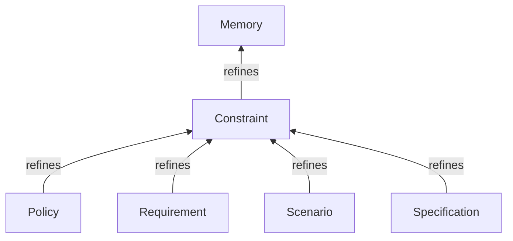
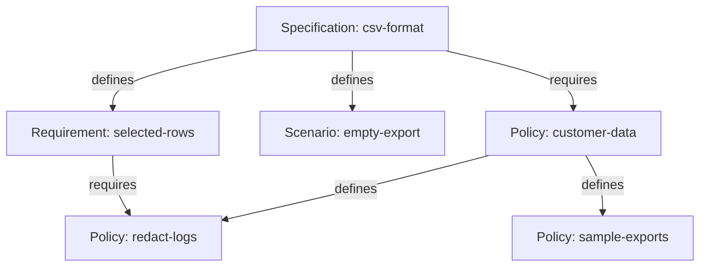
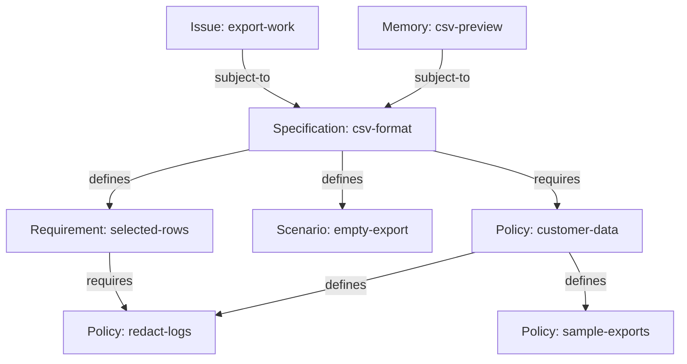

# Working with Tasks and Memories with Preview 3, Part 2: Constraints

<!-- Part 2 split; source prose, CLI examples and diagrams retained. Derived from preview3-blog.md snapshot 96782730f1e33480c96bf902eb4c24014da5eaba665ce28016f79e567fd03ca7 on October 26, 2026. Examples remain illustrative; the original b27 transcript attribution is historical. The acceptance-build link selects source, not a binary installer or release signoff. These split drafts are independent editorial copies, not verbatim-sync sources for the spec or runbook. -->

<!-- Donna: Part 2 opening / short recap of the CSV example. -->
*Continued from [Part 1](preview3-blog-part1-edited.md).*

## Constraints

Generic Memory Beads and References Links (created with `--type memory` and `--type references` respectively) don't have a lot of semantics associated with them. They create a graph of Markdown-based information with a descriptive title and an optional status. What the memory means and how it should be used is implicit in the markdown body.

The `superseded-by` link actually makes a semantic statement; the source bead has been retired and replaced by the target bead.  The meaning is clear, and the discovery is explicit and deterministic.

The family of constraint bead and link types also make semantic statements, whose meaning is clear, and discovery is equally explicit and deterministic.

### Constraint Beads

Some memories state what work must do, what it must avoid, or how it must be
carried out. A Constraint Bead records one of these obligations. Its body
describes the rule, and its Type tells readers what kind of rule they are
reading.

- A Policy Bead states governing rules or adopted directions for a system, project or team.
- A Requirement Bead states an outcome or condition that must be met.
- A Scenario Bead describes required behavior in a particular situation.
- A Specification Bead describes intended results at any useful level of detail.

You can use the Constraint Bead Type directly if none of the more specific Bead Types fits.

An adopted choice that governs later work is a Policy; record its scope,
rationale and authority in existing content and metadata. A historical account
of a choice that imposes no continuing rule is a plain Memory. A `superseded-by`
Link can connect a Policy to its replacement, but does not approve that
replacement or rewrite existing Subject To declarations. A required way of
working is a Policy with the steps and conditions in its body; optional how-to
guidance is a plain Memory.

These four Types refine Constraint, which itself refines Memory. The Type diagram
points from each refinement to its parent.



For CSV export, create a Specification, a Requirement and an empty-selection
Scenario. The `remember --type` creation option chooses each installed
Type by name; a separate customer-data Policy supplies rules used by more than
this feature, with two more Policy Beads for its details.

```console
# Describe the feature's intended result.
> bd memory remember 'Export the selected rows and follow the rules linked below.' \
  --key csv-format --title 'CSV export format' --type specification --create-only
Created csv-format [specification] "CSV export format"

# State which rows must appear in the file.
> bd memory remember 'Every selected row appears exactly once.' \
  --key selected-rows --title 'Export every selected row' --type requirement --create-only
Created selected-rows [requirement] "Export every selected row"

# State the expected result for an empty selection.
> bd memory remember 'Produce headings and no data rows.' \
  --key empty-export --title 'Export an empty selection' --type scenario --create-only
Created empty-export [scenario] "Export an empty selection"

# Record the independently maintained customer-data Policy.
> bd memory remember 'Keep personal information out of logs and sample exports.' \
  --key customer-data --title 'Protect customer data' --type policy --create-only
Created customer-data [policy] "Protect customer data"

# Record the log-handling detail as an ordinary Policy Bead.
> bd memory remember 'Remove personal information before writing log entries.' \
  --key redact-logs --title 'Redact application logs' --type policy --create-only
Created redact-logs [policy] "Redact application logs"

# Record the sample-data detail as another Policy Bead.
> bd memory remember 'Use anonymized records in shared sample exports.' \
  --key sample-exports --title 'Use anonymized sample exports' --type policy --create-only
Created sample-exports [policy] "Use anonymized sample exports"

```

Each record has its own identity and can be read, revised or referenced
independently. The next section connects them into defining trees and
cross-references.

## Constraint Bead Graphs

Like a generic `--type memory` bead, the `--type references` link is fairly semantics free. You can traverse the memory graph, but why two beads are linked with a `references` link is implicit and based on context.

Constraint graphs rely on specific link types (Requires and Defines) to express compound constraints and cross-referenced dependencies. Both link types connect two Constraint Beads and indicate that the source's constraints cannot be satisfied unless the target's constraints have also been met.

- A `defines` Link builds a compound constraint: a Policy can define subpolicies, or a Specification can define Requirements and Specifications.
- A `requires` Link can cross-reference constraints maintained in other Specifications, Policies or defining trees. Defines refines Requires, so a Requires-family traversal includes Defines Links too.

Defines Links form defining trees: each child has at most one defining parent, and the trees cannot cycle. Requires Links may form cycles; traversals must detect repeated visits and terminate even when cycles occur. Graph queries can collect the necessary obligations reached through the Requires family, including Defines.

A defining child keeps its own identity and can be required from another tree
without acquiring a second defining parent.

Six commands create and follow these relationships:

- `bd memory defines PARENT CHILD` creates a Defines Link, making the child part of the parent's definition.
- `bd memory definition REF... [--depth N]` follows outgoing Defines Links to read defining parts.
- `bd memory defined-by REF... [--depth N]` follows incoming Defines Links to find defining parents, showing the direct parent by default.
- `bd memory requires SOURCE TARGET` creates a Requires Link to another Constraint that must also be met.
- `bd memory requirements REF... [--depth N]` follows outgoing Requires-family Links, including Defines, to read the necessary constraints.
- `bd memory required-by REF... [--depth N]` follows incoming Requires-family Links to find dependent Constraints, showing direct dependents by default.

```console
# Make the selected-row Requirement part of the Specification's definition.
> bd memory defines csv-format selected-rows
Created Link: csv-format --defines--> selected-rows

# Make the empty-selection Scenario another defining part.
> bd memory defines csv-format empty-export
Created Link: csv-format --defines--> empty-export

# Give the customer-data Policy its log-handling detail.
> bd memory defines customer-data redact-logs
Created Link: customer-data --defines--> redact-logs

# Give the customer-data Policy its sample-data detail.
> bd memory defines customer-data sample-exports
Created Link: customer-data --defines--> sample-exports

# Require that independently maintained Policy from the CSV Specification.
> bd memory requires csv-format customer-data
Created Link: csv-format --requires--> customer-data

# Require the same log-handling Policy from the selected-row Requirement.
> bd memory requires selected-rows redact-logs
Created Link: selected-rows --requires--> redact-logs

```

The Specification and customer-data Policy each have a defining tree. The last
Requires Link crosses between them: the log-handling Policy keeps its defining
parent even though the selected-row Requirement also requires it.



Each linked target must be met for its source to be met; the source's own text
still applies, and only an explicit statement makes its listed children
exhaustive. The reads below distinguish defining parts from the broader
Requires family, which includes the separate Policies and the cross-reference.

```console
# Read the Specification's defining Requirement and Scenario.
> bd memory definition csv-format
csv-format [specification] CSV export format
├─ defines → selected-rows [requirement] Export every selected row
└─ defines → empty-export [scenario] Export an empty selection

# Read its defining parts and the separate Policies it requires.
> bd memory requirements csv-format
csv-format [specification] CSV export format
├─ defines → selected-rows [requirement] Export every selected row
│  └─ requires → redact-logs [policy] Redact application logs
├─ defines → empty-export [scenario] Export an empty selection
└─ requires → customer-data [policy] Protect customer data
   ├─ defines → redact-logs (already shown)
   └─ defines → sample-exports [policy] Use anonymized sample exports

# Find the direct defining parent of the selected-row Requirement.
> bd memory defined-by selected-rows
selected-rows [requirement] Export every selected row
└─ defines ← csv-format [specification] CSV export format

# Find Constraints that directly require the log-handling Policy.
> bd memory required-by redact-logs
redact-logs [policy] Redact application logs
├─ defines ← customer-data [policy] Protect customer data (depth limit)
└─ requires ← selected-rows [requirement] Export every selected row (depth limit)

# Display only the current Defines tree with the Beads graph viewer.
> bd graph csv-format --link-type defines --direction out --depth 1000
csv-format [specification] CSV export format
├─ defines → selected-rows [requirement] Export every selected row
└─ defines → empty-export [scenario] Export an empty selection

# Display the Requires family, including Defines and the cross-reference.
> bd graph csv-format --link-type requires --direction out --depth 1000
csv-format [specification] CSV export format
├─ defines → selected-rows [requirement] Export every selected row
│  └─ requires → redact-logs [policy] Redact application logs
├─ defines → empty-export [scenario] Export an empty selection
└─ requires → customer-data [policy] Protect customer data
   ├─ defines → redact-logs (already shown)
   └─ defines → sample-exports [policy] Use anonymized sample exports

```

## Applying Constraints

People and agents need to know which constraints apply to a piece of work. They
can find relevant rules from context or follow explicit declarations in the graph.

The constraint graphs we just looked at express what conditions must be true in a given context, but they are silent on how that context is established.

The most obvious and flexible way to determine who or what is subject to a constraint graph is implicit inference. An agent may infer relevant constraints from a prompt or ambient context. For example,
a Policy may state that all bug fixes must include a regression test. The constraint's subjects can be identified this way, but we are relying on inference to find them.

The alternative way to determine the subjects of a constraint is to use the `subject-to` Link. A `subject-to` Link explicitly connects a Bead to a Constraint that governs it.
Any Bead, including an Issue, can be the source, and it can have several such
declarations. Starting from those Constraints, a read can follow Requires and
Defines to deterministically find the set of rules the bead is subject to.

Three commands declare and discover these relationships:

- `bd memory subject-to SUBJECT CONSTRAINT` declares that a Bead is governed by a Constraint.
- `bd memory constraints SUBJECT...` discovers each subject's explicit declarations and the Requires-family paths, including Defines, that follow from them.
- `bd memory subjects CONSTRAINT...` finds Beads that directly declare they are subject to the selected Constraints.

For the CSV example, declare that the implementation Issue and a note about the
preview build are both subject to the CSV Specification. The Issue records the
implementation work; the Memory records knowledge about the build.

```console
# Record a note about the preview build as a second kind of subject.
> bd memory remember 'The CSV preview build is ready for review.' \
  --key csv-preview --title 'CSV preview build' --create-only
Created csv-preview [memory] "CSV preview build"

# Declare which Specification governs the implementation Issue.
> bd memory subject-to export-work csv-format
Created Link: export-work --subject-to--> csv-format

# Declare that the same Specification governs the preview-build note.
> bd memory subject-to csv-preview csv-format
Created Link: csv-preview --subject-to--> csv-format

```

The Issue and the Memory are different kinds of subject governed by the same
Specification. From either subject, its explicit declaration leads into the
Specification's Requires family, including Defines.



The supporting paths explain why each rule was reached for its original subject.
`constraints` follows those declarations and dependencies; `subjects` answers
the direct reverse question of which Beads name this Constraint.

```console
# Discover the rules explicitly governing the implementation Issue.
> bd memory constraints export-work
export-work [task] Add CSV export
└─ subject-to → csv-format [specification] CSV export format
   ├─ defines → selected-rows [requirement] Export every selected row
   │  └─ requires → redact-logs [policy] Redact application logs
   ├─ defines → empty-export [scenario] Export an empty selection
   └─ requires → customer-data [policy] Protect customer data
      ├─ defines → redact-logs (already shown)
      └─ defines → sample-exports [policy] Use anonymized sample exports

# Keep the paths for both subjects visible in one read.
> bd memory constraints export-work csv-preview
export-work [task] Add CSV export
└─ subject-to → csv-format [specification] CSV export format
   ├─ defines → selected-rows [requirement] Export every selected row
   │  └─ requires → redact-logs [policy] Redact application logs
   ├─ defines → empty-export [scenario] Export an empty selection
   └─ requires → customer-data [policy] Protect customer data
      ├─ defines → redact-logs (already shown)
      └─ defines → sample-exports [policy] Use anonymized sample exports

csv-preview [memory] CSV preview build
└─ subject-to → csv-format [specification] CSV export format
   ├─ defines → selected-rows [requirement] Export every selected row
   │  └─ requires → redact-logs [policy] Redact application logs
   ├─ defines → empty-export [scenario] Export an empty selection
   └─ requires → customer-data [policy] Protect customer data
      ├─ defines → redact-logs (already shown)
      └─ defines → sample-exports [policy] Use anonymized sample exports

# Find the subjects that directly declare the CSV Specification.
> bd memory subjects csv-format
csv-format [specification] CSV export format
├─ subject-to ← export-work [task] Add CSV export
└─ subject-to ← csv-preview [memory] CSV preview build

```
These declarations help readers discover the rules; they do not prove
compliance or change Issue readiness. Readiness and scheduling continue to
follow their workflow and Dependency rules.

Subject To does not spread through other Subject To declarations. A
document-review Policy governing the Specification applies to that document; it
does not automatically govern the implementation Issue. Declare the relationship
to the Issue explicitly when that is intended.

A prompt can direct an agent to follow the customer-data Policy today. A future
executable applicability feature might select subjects using a predicate. This
walkthrough discovers stored declarations and their Requires paths.


## An example closer to home

We just walked through some fairly tiny examples to demonstrate the core capabilities of the system.  The concepts and mechanisms have been tested out throughout the production of this feature set, but the examples are honestly toys.

A more fully fleshed out example is the [Memory proposal](https://github.com/gastownhall/beads/issues/5877) that kicked off this project. It gives us a concrete example from out in the wild, and it maps very cleanly to the constraint memory bead types we just looked at.

We can represent the proposal as a Specification Bead, with 32 Requirement Beads and 16 Scenario Beads as its defining constraint. Each constraint retains its original text and complete title, including its `Rn` or `Sn` prefix; R27a accounts for the extra Requirement beyond R1–R31.

### Start with the Specification

For this example, we create a new scope to contain the proposal and its extracted Beads. The extraction retains the complete source titles and bodies. The displays below illustrate that arrangement; the proposal is represented through Bead and Link creation, rather than passed directly to `bd import`.

The Specification's body retains the proposal's other text verbatim: its
status and revision notes, Summary, Goals, Core model, Technical considerations,
Open questions and Out of scope. The Requirements and Scenarios carry their own
original titles and bodies as separate defining Beads. The compact displays
below are illustrations with elisions, rather than exact terminal transcripts
or a claim that the proposal has been implemented.

```console
# Read the Specification's title and original proposal prose (output excerpt).
> bd show memory-proposal
ID:       memory-proposal
Type:     specification
Title:    Memory Beads
Revision: [current revision]

…
## Summary
Beads already has a small memory feature: `bd remember` stores a string under a key, `bd recall` reads it, `bd memories` lists or searches the key/value set, and `bd forget` removes a found non-empty entry. Out-of-band empty rows survive `forget` and require recovery. `bd prime` can inject memory bodies at session start. This is useful for a few reminders, but the storage model has no canonical Bead identity, no history reachable through the memory commands, no structured change authorship, no per-memory version identity, no explicit links, no way to remove a memory without losing its record, and no way for a task to cite the exact knowledge it used.

The gap shows up whenever project knowledge matters for more than one session. A corrected policy can silently replace the only copy of the old policy. A task cannot identify the exact historical state it was written against. Humans and agents cannot inspect how a decision changed or who changed it. At startup, loading every remembered body spends context before the agent knows what it needs.
…

```

The proposal's Summary gives readers a starting point, while the complete
Specification body retains the surrounding rationale and scope. The Requirements and Scenarios remain independently addressable, so a discussion or implementation task can refer to a particular part of the proposal.

```console
# List Requirement Beads in this focused Scope.
> bd list --type requirement
ID           TYPE          TITLE
memory-r1    requirement   R1. Memory is a…
memory-r2    requirement   R2. Canonical identity does…
…
memory-r30   requirement   R30. Core preserves evidence…
memory-r31   requirement   R31. Every target addition…

```

These excerpts show the first two and last two entries in the proposal's order. R27a and the other intervening Requirements are present in the stored data. This presentation order does not promise automatic numeric sorting by the CLI.

```console
# List Scenario Beads in this focused Scope.
> bd list --type scenario
ID           TYPE       TITLE
memory-s1    scenario   S1. Record durable knowledge…
memory-s2    scenario   S2. Search before writing…
…
memory-s15   scenario   S15. Temporary knowledge carries…
memory-s16   scenario   S16. An application…

```

The ellipses shorten this presentation; the stored titles and bodies remain complete. In a shared Scope, these commands would also list other matching Beads: the Type filter does not select membership in this particular Specification.

### Follow the definition and its requirements

The lists show what exists, but they do not explain how those Beads form a document. Defines Links make each extracted Requirement and Scenario part of the Specification's definition. Both kinds of child are directly defined by the root Specification, as siblings. A Scenario may exercise several Requirements, so its place in the document does not force it to belong to just one of them.

```console
# Explore the Specification's defining Requirements and Scenarios.
> bd memory definition memory-proposal
memory-proposal [specification] Memory Beads
├─ defines → memory-r1  [requirement] R1. Memory is a…
├─ defines → memory-r2  [requirement] R2. Canonical identity does…
│  …
├─ defines → memory-r30 [requirement] R30. Core preserves evidence…
├─ defines → memory-r31 [requirement] R31. Every target addition…
├─ defines → memory-s1  [scenario] S1. Record durable knowledge…
├─ defines → memory-s2  [scenario] S2. Search before writing…
│  …
├─ defines → memory-s15 [scenario] S15. Temporary knowledge carries…
└─ defines → memory-s16 [scenario] S16. An application…

```

Defines is a refinement of Requires: a defining child is something that must be met for its parent to be met. The broader requirements read therefore includes the same defining children, along with any additional Requires Links. It preserves `defines` labels rather than relabeling those edges as `requires`.

```console
# Discover the Specification's defining parts and any other required Constraints.
> bd memory requirements memory-proposal
memory-proposal [specification] Memory Beads
├─ defines → memory-r1  [requirement] R1. Memory is a…
├─ defines → memory-r2  [requirement] R2. Canonical identity does…
│  …
├─ defines → memory-r30 [requirement] R30. Core preserves evidence…
├─ defines → memory-r31 [requirement] R31. Every target addition…
├─ defines → memory-s1  [scenario] S1. Record durable knowledge…
├─ defines → memory-s2  [scenario] S2. Search before writing…
│  …
├─ defines → memory-s15 [scenario] S15. Temporary knowledge carries…
└─ defines → memory-s16 [scenario] S16. An application…

```

With only the Defines Links shown above, this read reaches the same children. If the Specification later requires an independently maintained Policy, that Policy appears in this broader view without becoming part of the Specification's defining tree. The proposal's S-number citations do not automatically create dependency Links among the extracted children.

```console
# Read the first Requirement's title and complete content.
> bd show memory-r1
ID:    memory-r1
Type:  requirement
Title: R1. Memory is a first-class core Bead kind.

This feature intentionally expands the Beads charter from project work alone to peer core concepts for project work and durable project knowledge. A Memory Bead uses `type: "memory"`, participates in the Bead graph, and exists beside Task Beads rather than beneath the task model. Readiness, assignment, priority, claiming, completion, closure, and workflow dependencies do not apply to it. Queries and mutations whose meaning requires Task workflow state do not select or affect a Memory, and a workflow mutation addressed to one fails with a typed error. Generic Bead operations such as listing by kind, showing identity, and graph traversal can include Memory Beads. _(S1, S3)_

# Read the first Scenario's Markdown body.
> bd memory recall memory-s1
A developer records why the project avoids a tempting dependency. They supply a Markdown body but no title or key. Beads derives a short title, creates a Memory Bead with a canonical ID and first attributed version, and does not invent a key. A human may add a familiar key later, or repoint one, while agents can continue using the canonical ID.

```

Each extracted Bead can be discussed, referenced and revised independently. The Specification preserves its relationship to the proposal, while the body carries the actual meaning. Discovering a Requirement establishes what must be met, not that anyone has met it.

## Where Are We

Preview 3 is the first preview that really shows the directional shape we are creating to satisfy the requirements set out in [the original Memory Beads proposal](https://github.com/gastownhall/beads/issues/5877).


Some major areas still need more work:

- Incorporating feedback on the previews, specifically the new memory bead/link types.
- Implementing the full provenance capabilities outlined in the Memory proposal. Recorded change attribution is available, but the complete provenance surface is unfinished.
- Implementing the rest of BDP to support the federation requirements outlined in Chris's proposal. The qualified preview surface covers BDP Read; HTTP writes, BDP History, and cross-Scope Links remain outside that surface.
- Ensuring that the entire Bead, Link, Issue, and Dependency surface works consistently.
- Ensuring that the remaining operational parts of the CLI work with and respect the new features and capabilities we are introducing.

Work on these areas is underway, but the full capabilities aren't ready for prime time. If your curiosity has you spelunking in those areas, prepare to be surprised in future previews.

Get the [Preview 3 source build](https://github.com/donnabox/beads/tree/preview3-acceptance-210f8da). Once again, try the workflow on a small disposable copy of a project and tell us where it helps or gets in your way. Join the conversation in the [Gas Town Hall Discord](https://discord.gg/xHpUGUzZp2), in the `#beads` and `#memory-beads` channels, or [file a Beads issue](https://github.com/gastownhall/beads/issues) with a `[Memory]` prefix. Feedback on the protocol itself can go straight to the [BDP repo](https://github.com/gastownhall/bdp/issues). Include the integration commit you tried so we can reproduce what you saw.

[Chris' memory proposal]: https://github.com/gastownhall/beads/issues/5877
