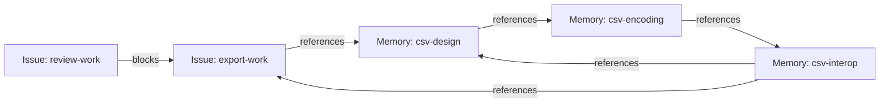
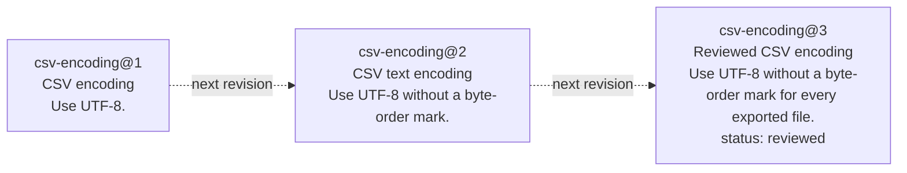
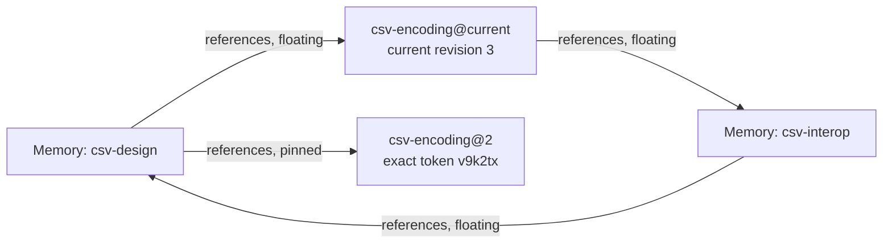
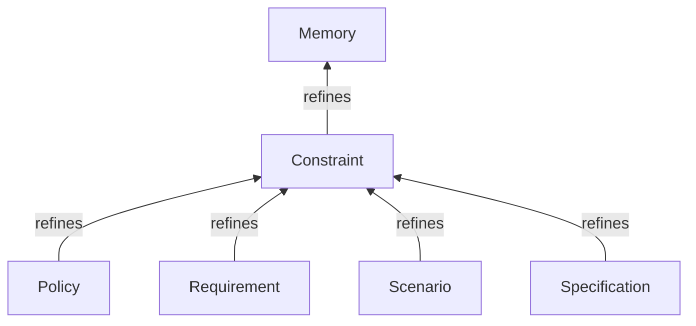
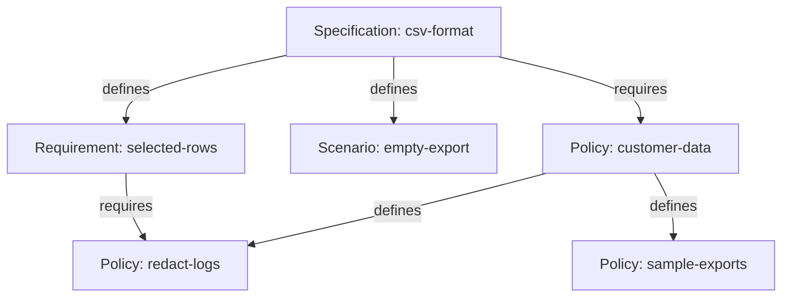
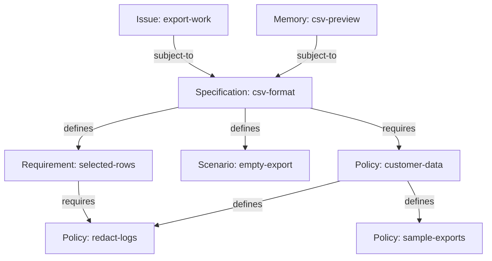

# Working with Tasks and Memories with Preview 3

We just pushed [Memory Beads Preview 3](https://github.com/donnabox/beads/tree/b27df1b0490bbffadadb399097a3b242d5e0677c) out the door. The first preview was there primarily to demonstrate a happy path through:

1. Generic graph structure that can span issue and non-issue beads. This mode is enabled by passing `--graph-mode link` to `bd init`, which creates a non-production-ready workspace that enables the new features.
2. A set of bead and link types that model how memories are modeled in beads.
3. An implementation of a protocol (BDP) designed to allow bead consumers and producers to interoperate and build graphs that span the scope of a single implementation.

The good news is, it all worked. The meh news is that the happy path was pretty narrow. Preview 2 added no new features; it just made the happy path wider, as does Preview 3. The Preview 3 bits have a lot of undone work that will take weeks and a few previews to grind out. But, Preview 3 has two *very* significant features:

1. Support for importing data from previous versions of beads. You can now export your data from an existing 1.3.* workspace and import it into a new `--graph-mode link` workspace.
2. The first draft of the Bead and Link Types that model how memory will work in beads, along with a memory-specific CLI surface (`bd memory`) for working with these types.

This blog covers both features, starting, of course, with how to bring up a workspace based on your existing data.

<!-- Editorial draft. Reference build: b27df1b0490bbffadadb399097a3b242d5e0677c. Type names reflect Donna’s agreed unprefixed surface; Trish owns the corresponding implementation update. Import structure was exercised on the reference build; normalized Type labels are editorial, not newly captured runtime output. Donna owns release wording and publication. -->

## Creating a `--graph-mode link` workspace from existing data

A new workspace starts out empty. No issue beads. No dependency links. No memory beads.  It's a lonely place that requires a heck of a lot of `bd create` calls to be interesting.

Preview 3 adds support for importing data from a workspace created with version 1.3 of beads into a fresh `--graph-mode link` workspace. Be forewarned that Preview 3 is **not** ready for production work, so import is really here so you can seed your workspace with **a copy** of data you recognize.

### Exporting your existing data

To export your data from an existing workspace, use the familiar `bd export` command from an existing 1.3.* build of `bd` that you either got from your favorite package manager or built from the gastownhall/beads repository.  By default, `export` will only export your issues and dependencies. If you want your memories to come along for the ride, add the `--include-memories` flag. The export command's normal filtering still applies if you want to bring over a subset of your beads and dependencies.

For these transcripts, I used the pinned source build `b27df1b04` in both
workspace modes. The existing workspace has three Issues, two dependencies
and two key/value memories: review waits for implementation, and
shipping waits for review. Its version output identifies that source build;
use your existing installation when exporting your own data. The export path
in the output is shortened with an ellipsis.

`--flat` keeps the source Issue list compact and shows its existing dependencies.

```console
# Check the source build in the ordinary workspace.
> bd version
bd version 1.3.0 (b27df1b04: master@b27df1b0490b)

# Inspect the Issues and their existing dependencies before exporting.
> bd list --all --flat
● legacy-ship [P2] [task] - Ship CSV export (blocked by: legacy-review)
● legacy-review [P2] [task] - Check CSV encoding (blocked by: legacy-export, blocks: legacy-ship)
○ legacy-export [P2] [task] - Implement CSV export (blocks: legacy-review)

# Inspect the key/value memories before exporting.
> bd memories
Memories (2):

  legacy-encoding
    Use UTF-8 for exported files.

  legacy-headings
    Include headings even when no rows are selected.

# Export current Issues, dependencies and key/value memories.
> bd export --include-memories --output /tmp/preview3-export.jsonl
Exported 3 issues and 2 memories to …/preview3-export.jsonl

```

An ordinary export carries current data. Earlier revisions, Dolt branches and the source database's history do not come with it. Keep this file unchanged while you test the conversion so that you have a clear source for comparison.

### Importing your data into a new `--graph-mode link` workspace

Switch to the selected Preview 3 executable before preparing the destination. Choose a new directory outside any existing Beads workspace, and initialize Git there so workspace discovery has a local boundary. The Scope URL supplies the workspace's identity; initializing it does not contact or start a web service. Import currently only works on empty workspaces, so perform the import *before* you start calling `bd create` in the new workspace.

```console
# Confirm that this terminal now uses the selected Preview 3 build.
> bd version
bd version 1.3.0 (b27df1b04: b27df1b0490b)

# Create a new practice directory outside the existing workspace.
> mkdir beads-preview3-trial

# Enter the new directory.
> cd beads-preview3-trial

# Give workspace discovery a local Git boundary.
> git init -q

# Initialize a fresh embedded graph workspace with its own Scope identity.
> bd init --graph-mode link --scope-url 'https://example.invalid/preview3-trial/'
Initialized disposable mixed graph preview. Use status --graph for supported commands; no migration or recovery compatibility is promised.

# List all Beads in the new workspace.
> bd list --type any --all
Beads (0; more: false; graph preview)

```

`bd list` shows that the new workspace has no Beads. Import the export file
to populate it, saving the result maps so you can inspect the destination
identities. The counts and maps below let you check which records arrived.

```console
# Import the export file into the fresh destination.
> bd import /tmp/preview3-export.jsonl --json > import-result.json

# Inspect imported record counts and their destination identities.
> jq '.result | {issues, memories, dependencies, ids, memory_ids, dependency_ids}' import-result.json
{
  "issues": 3,
  "memories": 2,
  "dependencies": 2,
  "ids": {
    "legacy-export": "https://example.invalid/preview3-trial/legacy-export",
    "legacy-review": "https://example.invalid/preview3-trial/legacy-review",
    "legacy-ship": "https://example.invalid/preview3-trial/legacy-ship"
  },
  "memory_ids": {
    "legacy-encoding": "https://example.invalid/preview3-trial/legacy-encoding",
    "legacy-headings": "https://example.invalid/preview3-trial/legacy-headings"
  },
  "dependency_ids": {
    "legacy-review -> legacy-export": "https://example.invalid/preview3-trial/sy64tg",
    "legacy-ship -> legacy-review": "https://example.invalid/preview3-trial/uwmjb6"
  }
}

```

The JSON output shows how many objects were imported, along with their
destination identities. Use the normal `bd` commands to inspect the imported
content and relationships: `--type any` includes Memories alongside Issues,
while `--all` includes closed Issues.

```console
# List Issues and Memories together, including closed Issues.
> bd list --type any --all
Beads (5; more: false; graph preview)
legacy-export [task] open P2 "Implement CSV export"
legacy-review [task] open P2 "Check CSV encoding"
legacy-ship [task] open P2 "Ship CSV export"
legacy-headings [memory] "Include headings even when no rows are selected."
legacy-encoding [memory] "Use UTF-8 for exported files."

# Browse both imported Memories.
> bd memory memories
Memories (2):

  legacy-encoding  Use UTF-8 for exported files.
    Use UTF-8 for exported files. (excerpt)
  legacy-headings  Include headings even when no rows are selected.
    Include headings even when no rows are selected. (excerpt)

Title/body summaries. Use bd recall <id> for full text; --details for versions, attribution and Links.

# Check that both dependencies survived as Links.
> bd link list
sy64tg [blocks] legacy-review → legacy-export
uwmjb6 [blocks] legacy-ship → legacy-review

```

Each imported Issue retains its public ID, and its Type is set to the corresponding Bead Type, which refines the common abstract Issue Type. The imported local dependencies become first-class Links of the corresponding Link Type, which refines the common abstract Dependency Type. The two Links preserve the chain: shipping waits for review, and review waits
for implementation.

If you passed the `--include-memories` flag at export time, classic key/value memories get translated to Beads of Type `memory`. The key becomes the memory bead's public ID and the exact value becomes its body, while its title is derived independently from that body. Memory Beads *are not* Issue Beads, and you can't link them using Dependency Links. We'll see later how to build graphs of memory beads with issue beads intermixed.

The importer refuses unsupported or conflicting data as a whole. This includes missing or cross-Scope dependency endpoints, incompatible IDs, unsupported custom Issue classifications or statuses, and source history payloads. Repeating an import into an occupied workspace refuses; deleting records does not make a used destination fresh again. This is a way to seed a new graph workspace, not a lossless in-place migration or portable graph round trip. Support will expand in future previews; this is a point-in-time build.

## Introducing Memory Beads

<!-- begin retained blog text - do not overwrite -->
This release is the first one containing intentionally designed bead types; Preview 2 had placeholder typenames (`preview-memory`, `preview-references`) that have now been replaced with types we beleive capture the common scenarios (and satisfy the requirements and scenarios laid out in [the Memory Beads proposal](https://github.com/gastownhall/beads/issues/5877)). The rest of this blog is a walk through of the new bead types.
<!-- end retained blog text - do not overwrite -->


<!-- begin imported section - please retain this comment for provanence -->
## Using Memory Beads and Links (informative)

The [Memory Type
spec](https://github.com/gastownhall/bdp/blob/94f699b947382e3a52385b1895a941575fcc08cb/specs/types/memory/memory.md#overview-informative)
introduces the model for Memory Beads in great detail. Here we describe the new
CLI surface for memory (`bd memory`) by walking through one small example: adding CSV
export to a product, keeping the design notes, and recording the rules the
feature must follow.

The installed Bead Type names used here include `memory`, `task` and `bug`;
Link Type names include `references`, `superseded-by` and `blocks`. The `issue`
and `dependency` Types are abstract, so creation selects a concrete refinement
such as `task`, `bug` or `blocks`.

The transcripts below show illustrative, abbreviated output; administrative
fields are omitted. Each example has a comment, a command prefixed with `>`,
and its output. Blocks described as alternatives demonstrate different ways
to perform the same operation.

### Creating Memories

Memory Beads record knowledge for later use by both humans and agents. Memory beads can represent policies, requirements, decisions, or generic information that doesn't fit into a particular category. Plain Memory is informative; the Constraint refinement introduced below adds normative rules while remaining a Memory.

A Memory Bead has a `title` and a Markdown `body`; its third property (`status`) is optional. Unlike Issues, where status defines a lifecycle specific to work tracking, the `status` field on Memory Beads is free-form text and can map onto whatever lifecycle you, your project, or your organization uses (e.g., PROPOSED or APPROVED).

Four commands work with Memory Beads:

- `bd memory remember [BODY] [--key ID | --update REF]` creates a Memory or edits an existing one.
- `bd memory recall REF` reads a Memory's Markdown body.
- `bd memory memories [SEARCH]` browses compact Memory summaries, optionally matching search text.
- `bd memory forget REF` deletes a Memory.

For the CSV feature in this walkthrough, we will start with a design note, an encoding
note and a note about spreadsheet interoperability. `bd memory remember` takes
the body as its argument. Use `--key`
to choose the identity and `--title` to choose the display text.

```console
# Record the initial design under an explicit ID and title.
> bd memory remember 'Export the selected rows as CSV.' \
  --key csv-design --title 'CSV export design' --create-only
Created csv-design [memory] "CSV export design"

# Record the text-encoding note that the design will refer to.
> bd memory remember 'Use UTF-8.' \
  --key csv-encoding --title 'CSV encoding' --create-only
Created csv-encoding [memory] "CSV encoding"

# Record the spreadsheet checks that connect the design to implementation work.
> bd memory remember 'Test the exported UTF-8 file in spreadsheet tools; keep the results with the implementation work.' \
  --key csv-interop --title 'CSV interoperability checks' --create-only
Created csv-interop [memory] "CSV interoperability checks"

```

The top-level `bd remember` command remains a compatibility alias for `bd memory
remember`. Because Memories are Beads, the general `bd create` can create the
same notes by naming the `memory` Type explicitly. The three spellings below
are alternatives to the first creation above; use one spelling when creating
the design note.

```console
# Create the design note using the top-level compatibility alias.
> bd remember 'Export the selected rows as CSV.' \
  --key csv-design --title 'CSV export design' --create-only
Created csv-design [memory] "CSV export design"

# Alternatively, create the same note using the Memory command group.
> bd memory remember 'Export the selected rows as CSV.' \
  --key csv-design --title 'CSV export design' --create-only
Created csv-design [memory] "CSV export design"

# Alternatively, create the same note using the general Bead command.
> bd create --id csv-design --type memory \
  --properties '{"title":"CSV export design","body":"Export the selected rows as CSV."}'
Created csv-design [memory] "CSV export design"

```

To finish out our scenario, let's create two Issues using the concrete `task` Type for implementing and reviewing the
feature. The Issues record the work, while the notes hold knowledge that helps
people carry it out. Issues use `description` for their text, while Memories
use `body`.

```console
# Create the implementation Issue.
> bd create --id export-work --type task \
  --properties '{"title":"Add CSV export","description":"Implement CSV export for the selected rows."}'
Created export-work [task] "Add CSV export"

# Create the review Issue.
> bd create --id review-work --type task \
  --properties '{"title":"Review CSV export","description":"Review the completed CSV export feature."}'
Created review-work [task] "Review CSV export"

```

Memory and Issue Beads work with the general Bead commands. We have created
three Memories and two Issues; use `bd list` to see them together in the mixed
inventory.

```console
# List Memory and Issue Beads together in the current Scope.
> bd list --type any
csv-design      [memory]  CSV export design
csv-encoding    [memory]  CSV encoding
csv-interop     [memory]  CSV interoperability checks
export-work     [task]  Add CSV export
review-work     [task]  Review CSV export

```

To see only Memories or tasks, filter the inventory with `--type`. The
memory-specific `bd memory memories` command, also available as `bd memories`,
provides compact Memory summaries rather than the general inventory's full
Resource formats and paging.

```console
# List the task Type family through the same general command.
> bd list --type task
export-work     [task]  Add CSV export
review-work     [task]  Review CSV export

# List the Memory Type family through the general Bead command.
> bd list --type memory
csv-design      [memory]  CSV export design
csv-encoding    [memory]  CSV encoding
csv-interop     [memory]  CSV interoperability checks

# Browse summaries through the top-level compatibility alias.
> bd memories
csv-design      [memory]  CSV export design
csv-encoding    [memory]  CSV encoding
csv-interop     [memory]  CSV interoperability checks

# Browse the same summaries through the Memory command group.
> bd memory memories
csv-design      [memory]  CSV export design
csv-encoding    [memory]  CSV encoding
csv-interop     [memory]  CSV interoperability checks

```

Likewise, inspect a Memory with the generic `bd show` command or the
memory-specific `bd memory recall`, also available as `bd recall`. The former
shows the Bead document, including its properties; the latter writes only its
Markdown body.

```console
# Inspect the design note as a Bead document.
> bd show csv-design
{
  "id": "csv-design",
  "type": "memory",
  "properties": {
    "title": "CSV export design",
    "body": "Export the selected rows as CSV."
  }
}

# Read only the design note's body through the Memory command group.
> bd memory recall csv-design
Export the selected rows as CSV.

# Read the same body through the top-level compatibility alias.
> bd recall csv-design
Export the selected rows as CSV.

```

Finally, delete a Memory with the general `bd delete` command or the
memory-specific `bd memory forget`, also available as `bd forget`. Create a
separate temporary note so the deletion example leaves the CSV notes available
for the rest of the walkthrough.

After creating the temporary note, choose one of the deletion commands below.
The deletion commands are alternatives. On the
general command, `--force` supplies the intent to apply the deletion, while
`forget` already expresses that intent.

```console
# Create a temporary Memory for the deletion examples.
> bd memory remember 'Temporary note for comparing deletion commands.' \
  --key deletion-demo
Created deletion-demo [memory]

# Delete the temporary Memory through the Memory command group.
> bd memory forget deletion-demo
Deleted deletion-demo.

# Alternatively, delete it through the top-level compatibility alias.
> bd forget deletion-demo
Deleted deletion-demo.

# Alternatively, apply the same deletion through the general Bead command.
> bd delete deletion-demo --force
Deleted deletion-demo.

```

These conveniences work with the same Beads as the general commands, with
Memory-specific defaults and rendering. The mapping for `bd update` is
different: `remember` supports both creating a new Memory and updating an
existing one by using the same key. On a new throwaway identity, these two
calls first create a note and then change its body, preserving its title.

```console
# Create a reminder under a new identity.
> bd memory remember 'Include column headings in CSV exports.' \
  --key remember-demo --title 'CSV headings reminder'
Created remember-demo [memory] "CSV headings reminder"

# Update that same Memory, leaving its title unchanged.
> bd memory remember 'Include headings even when no rows are selected.' \
  --key remember-demo
Updated remember-demo [memory] "CSV headings reminder"

```

The following general commands are an alternative way to perform those two
operations. Choose either this block or the preceding one for the new
`remember-demo` identity.

```console
# Create the same reminder through the general Bead command.
> bd create --id remember-demo --type memory \
  --properties '{"title":"CSV headings reminder","body":"Include column headings in CSV exports."}'
Created remember-demo [memory] "CSV headings reminder"

# Apply the same body change through the general update command.
> bd update remember-demo \
  --set-property body='Include headings even when no rows are selected.'
Updated remember-demo [memory] "CSV headings reminder"

```

After either block, the identity already exists. Supplying `--create-only`
refuses to overwrite it; the stored title and body remain unchanged.

```console
# Refuse to create another Memory at an identity already used above.
> bd memory remember 'This text must not replace the saved reminder.' \
  --key remember-demo --title 'A competing reminder' --create-only
Error: remember-demo already exists; --create-only refused the write.

```

### Linking Memories

References Links connect memory beads so that readers can follow useful related context.  There is a distinct new link type, `references`, that connects memory beads to one another or to beads of any type (e.g., `task`). Reference links share the same three properties as memory beads (title, body, status) allowing you to treat references between memories as full-fledged parts of the memory graph; unlike memory beads however, all three of these fields are optional. Reference links can be created using the memory-specific `bd memory reference` command or the generic `bd link create` command that works with all link types.

Direct References provide informative context. Requires and Subject To state
obligations, and Defines adds defining structure to Requires; these specialized
Links are also References. Superseded By expresses normative succession: it
directs readers to the successor for current guidance. It does not automatically
approve that successor, change status, rewrite Subject To declarations or erase
history.

Three commands create and follow References Links:

- `bd memory reference SOURCE TARGET` creates a References Link from the source to the target.
- `bd memory references REF... [--depth N]` follows outgoing References Links to find related context.
- `bd memory referenced-by REF... [--depth N]` follows incoming References Links to find Beads that refer to the selected Beads.

In our example, the design uses the encoding note, which points to the interoperability checks;
those checks refer back to the design. The checks also point to the
implementation Issue, which refers to the design it implements. These
connections form one cycle entirely among Memories and another through an
Issue. A title or body on a Link can explain why the connection matters. The last
References creation uses `bd link create`, which creates the same kind of Link
as `bd memory reference` by naming its Type explicitly.

```console
# Explain which encoding note the design uses.
> bd memory reference csv-design csv-encoding --id encoding-context \
  --title 'Uses this encoding' --body 'Text encoding for exported files'
Created encoding-context: csv-design --references--> csv-encoding

# Connect the encoding choice to its spreadsheet checks.
> bd memory reference csv-encoding csv-interop --id encoding-checks \
  --title 'Interoperability checks for this encoding'
Created encoding-checks: csv-encoding --references--> csv-interop

# Close the References cycle among the three Memories.
> bd memory reference csv-interop csv-design --id checks-design \
  --title 'Design these checks validate'
Created checks-design: csv-interop --references--> csv-design

# Connect the interoperability checks to the work recording their results.
> bd memory reference csv-interop export-work --id checks-work \
  --title 'Implementation and verification work'
Created checks-work: csv-interop --references--> export-work

# Close the References cycle that passes through the implementation Issue.
> bd link create export-work csv-design --type references --id design-context \
  --properties '{"title":"Implementation context"}'
Created design-context: export-work --references--> csv-design

# Make the review Issue depend on completion of the implementation Issue.
> bd link create review-work export-work --type blocks \
  --id review-after-export
Created review-after-export: review-work --blocks--> export-work

```

The three notes form a permitted References cycle. A second cycle follows the
same encoding and interoperability notes through the implementation Issue and
back to the design. The `blocks` Dependency separately says that review waits
for implementation; References supply context without imposing that workflow.




All links, including `references`, `blocks`, etc, can be updated without recreating them using the `bd link update` command.

A References Link can carry a free-form status just as a Memory can. Metadata
is available on both References and Dependency Links, independently of their
Type-specific properties. These edits keep the existing Link identities.

```console
# Mark the encoding reference reviewed and record its reviewer in metadata.
> bd link update encoding-context --set-property status=reviewed \
  --set-metadata reviewer=csv-review
Updated encoding-context.
{
  "properties": {
    "status": "reviewed"
  },
  "metadata": {
    "reviewer": "csv-review"
  }
}

# Record why the review depends on implementation without adding a property.
> bd link update review-after-export \
  --set-metadata rationale='Review after implementation'
Updated review-after-export.
{
  "metadata": {
    "rationale": "Review after implementation"
  }
}

```


The generic `bd graph` has been updated to handle cyclic references no matter what the link type is, and can filter out only links of a specific type (e.g., `references`, `blocks`).  For convenience, the `bd memory references` and `bd memory referenced-by` will show the graph of memory references in either outbound or inbound direction,

```console
# Find the design note's direct context.
> bd memory references csv-design
csv-design [memory] CSV export design
└─ references → csv-encoding [memory] CSV encoding (depth limit)

# Follow References farther to include both cycles.
> bd memory references csv-design --depth 4
csv-design [memory] CSV export design
└─ references → csv-encoding [memory] CSV encoding
   └─ references → csv-interop [memory] CSV interoperability checks
      ├─ references → csv-design (cycle)
      └─ references → export-work [task] Add CSV export
         └─ references → csv-design (cycle)

# Find Beads that refer to the design note.
> bd memory referenced-by csv-design
csv-design [memory] CSV export design
├─ references ← csv-interop [memory] CSV interoperability checks (depth limit)
└─ references ← export-work [task] Add CSV export (depth limit)
Cross-link: csv-interop --references→ export-work

# Explore the References graph far enough to encounter both cycles.
> bd graph csv-design --link-type references --direction out --depth 4
csv-design [memory] CSV export design
└─ references → csv-encoding [memory] CSV encoding
   └─ references → csv-interop [memory] CSV interoperability checks
      ├─ references → csv-design (cycle)
      └─ references → export-work [task] Add CSV export
         └─ references → csv-design (cycle)

```

### Memories Over Time

There are two ways for memory to evolve over time. The simplest way is simply by updating the memory in place. Its id/key stays the same, it just takes on new values. If you are simply changing the specifics of a given memory but it plays the same role as it did before, this is likely the way to go.

Sometimes however, fundamentally new memories need to be created that effectively replace one or more memories. In this case, agents or humans who reference the memory that's been retired need the ability to know which replacement is in effect.

Both of these scenarios are supported. Let's look at the first one first.


#### Revising a Memory

A revision identifies an immutable saved state of a Bead. An update that changes
its state records a new revision; the id/key stays constant while the state it
references evolves. Deleting a Bead does not rewrite its earlier states. Most
read commands let you select the current state or, using `@` syntax, a specific
retained revision from the past.

To see revisions in action, let's update the encoding note twice, changing its title and body each time and marking the final state reviewed. Both edits keep the ID `csv-encoding`. An unchanged update
leaves the revision unchanged. `bd versions` lists the saved states so that a
reader can select one explicitly.

```console
# Clarify the encoding requirement while keeping the same note.
> bd update csv-encoding --set-property title='CSV text encoding' \
  --set-property body='Use UTF-8 without a byte-order mark.'
Updated csv-encoding; revision v9k2tx.

# Refine the title and body again and label the note reviewed.
> bd update csv-encoding --set-property title='Reviewed CSV encoding' \
  --set-property body='Use UTF-8 without a byte-order mark for every exported file.' \
  --set-property status=reviewed
Updated csv-encoding; revision c6r8wn.

# List the revisions saved for this identity.
> bd versions csv-encoding
SEQ  REVISION  TITLE
1    m7q4pf    CSV encoding
2    v9k2tx    CSV text encoding
3    c6r8wn    Reviewed CSV encoding

```

`SEQ` is the store-local revision number; `REVISION` is the exact stable token
for the same revision, used after `@=`. The short, random-looking tokens in
these illustrations are invented; actual tokens are opaque and may be much
longer. Use the complete token returned by the store when making an exact
reference.

All three revisions share the same id/key (`csv-encoding`). Use `@2` to select
local revision number 2, or `@=v9k2tx` to select that revision by its exact
token. These are *pinned* references. Omitting the suffix produces an unpinned
or *floating* reference, which selects the latest state when used.

The diagram shows three saved states of one identity,
with dotted arrows indicating revision history rather than stored Links.




Here is an example showing unpinned/floating references as well as pinned references using `@` and `@=` to point to a specific revision.

```console
# Read the current note.
> bd show csv-encoding
{
  "id": "csv-encoding",
  "type": "memory",
  "revision": "c6r8wn",
  "properties": {
    "title": "Reviewed CSV encoding",
    "body": "Use UTF-8 without a byte-order mark for every exported file.",
    "status": "reviewed"
  }
}

# Read the saved second revision from this example.
> bd show csv-encoding@2
{
  "id": "csv-encoding",
  "type": "memory",
  "revision": "v9k2tx",
  "properties": {
    "title": "CSV text encoding",
    "body": "Use UTF-8 without a byte-order mark."
  }
}

# Recall just the body of that saved revision.
> bd memory recall csv-encoding@2
Use UTF-8 without a byte-order mark.

# Select the same illustrative revision using its exact token.
> bd show csv-encoding@=v9k2tx
{
  "id": "csv-encoding",
  "type": "memory",
  "revision": "v9k2tx",
  "properties": {
    "title": "CSV text encoding",
    "body": "Use UTF-8 without a byte-order mark."
  }
}

```

The Memory convenience command can also edit an existing note while preserving
omitted content. This title-only example leaves the body unchanged and makes no
new revision if the title is already equal.

```console
# Change only the existing note's title through the Memory command.
> bd memory remember --update csv-encoding --title 'Reviewed CSV encoding'
Unchanged csv-encoding; revision c6r8wn.

```

An unpinned Reference follows the current revision of its target. A pin selects
one exact saved revision, which is useful when recording the version a design
relied on. Add another References Link to revision 2, keeping the original
floating Link alongside it.

```console
# Record the exact encoding revision used by the design.
> bd memory reference csv-design csv-encoding@2 --id encoding-used \
  --title 'Encoding revision used for the design'
Created encoding-used: csv-design --references--> csv-encoding@2

```

Both Links identify the same encoding Bead. The diagram separates its current
and saved representations to make their different revision selections visible.



The pinned Link keeps its exact target token through later edits to the note.
The generic graph viewer can show that stored pin alongside current Bead bodies;
it does not fetch the old body for display. Focused Memory reads require
current-compatible pins in the selected Preview 3 adapter and can refuse this
older pin. Canonical graph reconciliation remains separate from the fixed
Memory questions in this document.

```console
# Inspect the References graph with its stored endpoint pins and current bodies.
> bd graph csv-design --link-type references --direction out --depth 1
csv-design [memory] CSV export design
├─ references [encoding-context, floating] → csv-encoding [memory] Reviewed CSV encoding (current body; depth limit)
└─ references [encoding-used, target pin =v9k2tx] → csv-encoding (same current body; depth limit)

```

The Memory update shorthand accepts `--title`, `--body` and `--status` while
preserving omitted content. Use `bd update` for the full property-edit surface
or a Type change.

#### Retiring a Memory using `superseded-by` links

Revisions allow a memory to evolve in place. Floating references pick up the latest state in that evolution; pinned references freeze at a moment in time. Because very few users of a bead are going to meticulously look through its revisions, it's difficult to know whether that evolution reflected refinement of the same fact, statement, or idea, or a direct contradiction. To make replacement obvious and discoverable, use the `superseded-by` link type to indicate that the source bead is being retired and the target bead holds the updated memory. Revisions over time of a given bead assume refinement; traversing beads through `superseded-by` assumes replacement.

Three commands create and follow Superseded By Links:

- `bd memory supersede OLD NEW` creates a Superseded By Link from a retiring Memory to its replacement.
- `bd memory successor REF... [--depth N]` follows the replacement chain forward from each retiring Memory.
- `bd memory supersedes REF... [--depth N]` follows the chain backward from a replacement, showing its direct predecessors by default.

For example, a short encoding note may eventually give way to a guide covering headings,
spreadsheet behavior and examples. Create the guide as a separately maintained
Memory. A Superseded By Link records that it replaces the old note. The old
identity and its earlier revisions remain readable.

```console
# Create the separately maintained replacement guide.
> bd memory remember 'Encoding, headings and spreadsheet examples.' \
  --key csv-guide --title 'CSV interoperability guide' --create-only
Created csv-guide [memory] "CSV interoperability guide"

# Record the old-to-new replacement.
> bd memory supersede csv-encoding csv-guide --id encoding-replacement
Created encoding-replacement: csv-encoding --superseded-by--> csv-guide

```

The replacement Link points from old to new and directs readers to the
successor for current guidance. This succession is normative: continuing to
follow the replaced guidance can conflict with that direction. This view shows
the Link beside the original forward Reference; the other References remain
unchanged.


The general Link command expresses the same replacement using the installed
`superseded-by` Type. This is an alternative to the preceding `bd memory
supersede` call.

```console
# Create the same replacement Link through the general command.
> bd link create csv-encoding csv-guide --type superseded-by \
  --id encoding-replacement
Created encoding-replacement: csv-encoding --superseded-by--> csv-guide

```

Each retiring Memory has at most one successor, and replacement chains cannot
cycle. Recording the Link revises the old Memory while leaving the replacement
unchanged. The focused reads below follow that replacement relationship in
either direction.

```console
# Follow the encoding note's replacement path.
> bd memory successor csv-encoding
csv-encoding [memory] Reviewed CSV encoding
└─ superseded-by → csv-guide [memory] CSV interoperability guide

# Find notes directly replaced by the guide.
> bd memory supersedes csv-guide
csv-guide [memory] CSV interoperability guide
└─ superseded-by ← csv-encoding [memory] Reviewed CSV encoding

# Display the current replacement path with the Beads graph viewer.
> bd graph csv-encoding --link-type superseded-by --direction out --depth 1000
csv-encoding [memory] Reviewed CSV encoding
└─ superseded-by → csv-guide [memory] CSV interoperability guide

```

### Constraints

#### Constraint Beads

Some memories state what work must do, what it must avoid, or how it must be
carried out. A Constraint Bead records one of these obligations. Its body
describes the rule, and its Type tells readers what kind of rule they are
reading. Use Constraint directly when none of the more specific Bead Types fits.

- Policy states governing rules or adopted directions for a system, project or team.
- Requirement states an outcome or condition that must be met.
- Scenario describes required behavior in a particular situation.
- Specification describes intended results at any useful level of detail.

An adopted choice that governs later work is a Policy; record its scope,
rationale and authority in existing content and metadata. A historical account
of a choice that imposes no continuing rule is a plain Memory. A `superseded-by`
Link can connect a Policy to its replacement, but does not approve that
replacement or rewrite existing Subject To declarations. A required way of
working is a Policy with the steps and conditions in its body; optional how-to
guidance is a plain Memory.

These four Types refine Constraint, which itself refines Memory. The Type diagram
points from each refinement to its parent.



For CSV export, create a Specification, a Requirement and an empty-selection
Scenario. The `remember --type` creation option chooses each installed
Type by name; a separate customer-data Policy supplies rules used by more than
this feature, with two more Policy Beads for its details.

```console
# Describe the feature's intended result.
> bd memory remember 'Export the selected rows and follow the rules linked below.' \
  --key csv-format --title 'CSV export format' --type specification --create-only
Created csv-format [specification] "CSV export format"

# State which rows must appear in the file.
> bd memory remember 'Every selected row appears exactly once.' \
  --key selected-rows --title 'Export every selected row' --type requirement --create-only
Created selected-rows [requirement] "Export every selected row"

# State the expected result for an empty selection.
> bd memory remember 'Produce headings and no data rows.' \
  --key empty-export --title 'Export an empty selection' --type scenario --create-only
Created empty-export [scenario] "Export an empty selection"

# Record the independently maintained customer-data Policy.
> bd memory remember 'Keep personal information out of logs and sample exports.' \
  --key customer-data --title 'Protect customer data' --type policy --create-only
Created customer-data [policy] "Protect customer data"

# Record the log-handling detail as an ordinary Policy Bead.
> bd memory remember 'Remove personal information before writing log entries.' \
  --key redact-logs --title 'Redact application logs' --type policy --create-only
Created redact-logs [policy] "Redact application logs"

# Record the sample-data detail as another Policy Bead.
> bd memory remember 'Use anonymized records in shared sample exports.' \
  --key sample-exports --title 'Use anonymized sample exports' --type policy --create-only
Created sample-exports [policy] "Use anonymized sample exports"

```

Each record has its own identity and can be read, revised or referenced
independently. The next section connects them into defining trees and
cross-references.

### Constraint Bead Graphs

Two Link Types connect Constraint Beads to express compound constraints and dependencies: Requires and Defines. Both connect two Constraint Beads and indicate that the source's constraints cannot be satisfied unless the target's constraints have also been met.

- A `defines` Link builds a compound constraint: a Policy can define subpolicies, or a Specification can define Requirements and Specifications.
- A `requires` Link can cross-reference constraints maintained in other Specifications, Policies or defining trees. Defines refines Requires, so a Requires-family traversal includes Defines Links too.

Defines Links form defining trees: each child has at most one defining parent, and the trees cannot cycle. Requires Links may form cycles; traversals must detect repeated visits and terminate even when cycles occur. Graph queries can collect the necessary obligations reached through the Requires family, including Defines.

Requires and Defines Links are owned by their source Constraint. Changing one revises that source while leaving its target unchanged. A defining child keeps its own identity and can be required from another tree without acquiring a second defining parent.

Six commands create and follow these relationships:

- `bd memory defines PARENT CHILD` creates a Defines Link, making the child part of the parent's definition.
- `bd memory definition REF... [--depth N]` follows outgoing Defines Links to read defining parts.
- `bd memory defined-by REF... [--depth N]` follows incoming Defines Links to find defining parents, showing the direct parent by default.
- `bd memory requires SOURCE TARGET` creates a Requires Link to another Constraint that must also be met.
- `bd memory requirements REF... [--depth N]` follows outgoing Requires-family Links, including Defines, to read the necessary constraints.
- `bd memory required-by REF... [--depth N]` follows incoming Requires-family Links to find dependent Constraints, showing direct dependents by default.

```console
# Make the selected-row Requirement part of the Specification's definition.
> bd memory defines csv-format selected-rows
Created Link: csv-format --defines--> selected-rows

# Make the empty-selection Scenario another defining part.
> bd memory defines csv-format empty-export
Created Link: csv-format --defines--> empty-export

# Give the customer-data Policy its log-handling detail.
> bd memory defines customer-data redact-logs
Created Link: customer-data --defines--> redact-logs

# Give the customer-data Policy its sample-data detail.
> bd memory defines customer-data sample-exports
Created Link: customer-data --defines--> sample-exports

# Require that independently maintained Policy from the CSV Specification.
> bd memory requires csv-format customer-data
Created Link: csv-format --requires--> customer-data

# Require the same log-handling Policy from the selected-row Requirement.
> bd memory requires selected-rows redact-logs
Created Link: selected-rows --requires--> redact-logs

```

The Specification and customer-data Policy each have a defining tree. The last
Requires Link crosses between them: the log-handling Policy keeps its defining
parent even though the selected-row Requirement also requires it.



Each linked target must be met for its source to be met; the source's own text
still applies, and only an explicit statement makes its listed children
exhaustive. The reads below distinguish defining parts from the broader
Requires family, which includes the separate Policies and the cross-reference.

```console
# Read the Specification's defining Requirement and Scenario.
> bd memory definition csv-format
csv-format [specification] CSV export format
├─ defines → selected-rows [requirement] Export every selected row
└─ defines → empty-export [scenario] Export an empty selection

# Read its defining parts and the separate Policies it requires.
> bd memory requirements csv-format
csv-format [specification] CSV export format
├─ defines → selected-rows [requirement] Export every selected row
│  └─ requires → redact-logs [policy] Redact application logs
├─ defines → empty-export [scenario] Export an empty selection
└─ requires → customer-data [policy] Protect customer data
   ├─ defines → redact-logs (already shown)
   └─ defines → sample-exports [policy] Use anonymized sample exports

# Find the direct defining parent of the selected-row Requirement.
> bd memory defined-by selected-rows
selected-rows [requirement] Export every selected row
└─ defines ← csv-format [specification] CSV export format

# Find Constraints that directly require the log-handling Policy.
> bd memory required-by redact-logs
redact-logs [policy] Redact application logs
├─ defines ← customer-data [policy] Protect customer data (depth limit)
└─ requires ← selected-rows [requirement] Export every selected row (depth limit)

# Display only the current Defines tree with the Beads graph viewer.
> bd graph csv-format --link-type defines --direction out --depth 1000
csv-format [specification] CSV export format
├─ defines → selected-rows [requirement] Export every selected row
└─ defines → empty-export [scenario] Export an empty selection

# Display the Requires family, including Defines and the cross-reference.
> bd graph csv-format --link-type requires --direction out --depth 1000
csv-format [specification] CSV export format
├─ defines → selected-rows [requirement] Export every selected row
│  └─ requires → redact-logs [policy] Redact application logs
├─ defines → empty-export [scenario] Export an empty selection
└─ requires → customer-data [policy] Protect customer data
   ├─ defines → redact-logs (already shown)
   └─ defines → sample-exports [policy] Use anonymized sample exports

```

### Applying Constraints

People and agents need to know which constraints apply to a piece of work. They
can find relevant rules from context or follow explicit declarations in the graph.

The constraint graphs we just looked at express what conditions must be true in a given context, but they are silent on how that context is established.

The most obvious and flexible way to determine who or what is subject to a constraint graph is implicit inference. An agent may infer relevant constraints from a prompt or ambient context. For example,
a Policy may state that all bug fixes must include a regression test. The constraint's subjects can be identified this way, but we are relying on inference to find them.

The alternative way to determine the subject(s) of a constraint are using the `subject-to` link, A `subject-to` Link explicitly connects a Bead to a Constraint that governs it.
Any Bead, including an Issue, can be the source, and it can have several such
declarations. Starting from those Constraints, a read can follow Requires and
Defines to deterministically find the set of rules the bead is subject to.

Three commands declare and discover these relationships:

- `bd memory subject-to SUBJECT CONSTRAINT` declares that a Bead is governed by a Constraint.
- `bd memory constraints SUBJECT...` discovers each subject's explicit declarations and the Requires-family paths, including Defines, that follow from them.
- `bd memory subjects CONSTRAINT...` finds Beads that directly declare they are subject to the selected Constraints.

For the CSV example, declare that the implementation Issue and a note about the
preview build are both subject to the CSV Specification. The Issue records the
implementation work; the Memory records knowledge about the build.

```console
# Record a note about the preview build as a second kind of subject.
> bd memory remember 'The CSV preview build is ready for review.' \
  --key csv-preview --title 'CSV preview build' --create-only
Created csv-preview [memory] "CSV preview build"

# Declare which Specification governs the implementation Issue.
> bd memory subject-to export-work csv-format
Created Link: export-work --subject-to--> csv-format

# Declare that the same Specification governs the preview-build note.
> bd memory subject-to csv-preview csv-format
Created Link: csv-preview --subject-to--> csv-format

```

The Issue and the Memory are different kinds of subject governed by the same
Specification. From either subject, its explicit declaration leads into the
Specification's Requires family, including Defines.



The supporting paths explain why each rule was reached for its original subject.
`constraints` follows those declarations and dependencies; `subjects` answers
the direct reverse question of which Beads name this Constraint.

```console
# Discover the rules explicitly governing the implementation Issue.
> bd memory constraints export-work
export-work [task] Add CSV export
└─ subject-to → csv-format [specification] CSV export format
   ├─ defines → selected-rows [requirement] Export every selected row
   │  └─ requires → redact-logs [policy] Redact application logs
   ├─ defines → empty-export [scenario] Export an empty selection
   └─ requires → customer-data [policy] Protect customer data
      ├─ defines → redact-logs (already shown)
      └─ defines → sample-exports [policy] Use anonymized sample exports

# Keep the paths for both subjects visible in one read.
> bd memory constraints export-work csv-preview
export-work [task] Add CSV export
└─ subject-to → csv-format [specification] CSV export format
   ├─ defines → selected-rows [requirement] Export every selected row
   │  └─ requires → redact-logs [policy] Redact application logs
   ├─ defines → empty-export [scenario] Export an empty selection
   └─ requires → customer-data [policy] Protect customer data
      ├─ defines → redact-logs (already shown)
      └─ defines → sample-exports [policy] Use anonymized sample exports

csv-preview [memory] CSV preview build
└─ subject-to → csv-format [specification] CSV export format
   ├─ defines → selected-rows [requirement] Export every selected row
   │  └─ requires → redact-logs [policy] Redact application logs
   ├─ defines → empty-export [scenario] Export an empty selection
   └─ requires → customer-data [policy] Protect customer data
      ├─ defines → redact-logs (already shown)
      └─ defines → sample-exports [policy] Use anonymized sample exports

# Find the subjects that directly declare the CSV Specification.
> bd memory subjects csv-format
csv-format [specification] CSV export format
├─ subject-to ← export-work [task] Add CSV export
└─ subject-to ← csv-preview [memory] CSV preview build

```

Subject To is owned by its source when that source's installed Type supports
this contract, including the required Issue ownership declaration. Editing the
Link revises that subject and leaves the target Constraint unchanged. These
declarations help readers discover the rules; they do not prove compliance or
change Issue readiness. Readiness and scheduling continue to follow their
workflow and Dependency rules.

Subject To does not spread through other Subject To declarations. A
document-review Policy governing the Specification applies to that document; it
does not automatically govern the implementation Issue. Declare the relationship
to the Issue explicitly when that is intended.

A prompt can direct an agent to follow the customer-data Policy today. A future
executable applicability feature might select subjects using a predicate. This
walkthrough discovers stored declarations and their Requires paths.

<!-- end imported section - please retain this comment for provanence -->

## An example closer to home

We just walked through some fairly tiny examples to demonstrate the core capabilities of the system.  The concepts and mechanisms have been tested out throughout the production of this feature set, but the examples are honestly toys.

A more fully fleshed out example is the [Memory proposal](https://github.com/gastownhall/beads/issues/5877) that kicked off this project. It gives us a concrete example from out in the wild, and it maps very cleanly to the constraint memory bead types we just looked at.

We can represent the proposal as a Specification Bead, with 32 Requirement Beads and 16 Scenario Beads as its defining constraint. Each constraint retains its original text and complete title, including its `Rn` or `Sn` prefix; R27a accounts for the extra Requirement beyond R1–R31.

### Start with the Specification

For this example, we create a new scope to contain the proposal and its extracted Beads. The extraction retains the complete source titles and bodies. The displays below illustrate that arrangement; the proposal is represented through Bead and Link creation, rather than passed directly to `bd import`.

The Specification's body retains the proposal's other text verbatim: its
status and revision notes, Summary, Goals, Core model, Technical considerations,
Open questions and Out of scope. The Requirements and Scenarios carry their own
original titles and bodies as separate defining Beads. The compact displays
below are illustrations with elisions, rather than exact terminal transcripts
or a claim that the proposal has been implemented.

```console
# Read the Specification's title and original proposal prose (output excerpt).
> bd show memory-proposal
ID:       memory-proposal
Type:     specification
Title:    Memory Beads
Revision: [current revision]

…
## Summary
Beads already has a small memory feature: `bd remember` stores a string under a key, `bd recall` reads it, `bd memories` lists or searches the key/value set, and `bd forget` removes a found non-empty entry. Out-of-band empty rows survive `forget` and require recovery. `bd prime` can inject memory bodies at session start. This is useful for a few reminders, but the storage model has no canonical Bead identity, no history reachable through the memory commands, no structured change authorship, no per-memory version identity, no explicit links, no way to remove a memory without losing its record, and no way for a task to cite the exact knowledge it used.

The gap shows up whenever project knowledge matters for more than one session. A corrected policy can silently replace the only copy of the old policy. A task cannot identify the exact historical state it was written against. Humans and agents cannot inspect how a decision changed or who changed it. At startup, loading every remembered body spends context before the agent knows what it needs.
…

```

The proposal's Summary gives readers a starting point, while the complete
Specification body retains the surrounding rationale and scope. The Requirements and Scenarios remain independently addressable, so a discussion or implementation task can refer to a particular part of the proposal.

```console
# List Requirement Beads in this focused Scope.
> bd list --type requirement
ID           TYPE          TITLE
memory-r1    requirement   R1. Memory is a…
memory-r2    requirement   R2. Canonical identity does…
…
memory-r30   requirement   R30. Core preserves evidence…
memory-r31   requirement   R31. Every target addition…

```

These excerpts show the first two and last two entries in the proposal's order. R27a and the other intervening Requirements are present in the stored data. This presentation order does not promise automatic numeric sorting by the CLI.

```console
# List Scenario Beads in this focused Scope.
> bd list --type scenario
ID           TYPE       TITLE
memory-s1    scenario   S1. Record durable knowledge…
memory-s2    scenario   S2. Search before writing…
…
memory-s15   scenario   S15. Temporary knowledge carries…
memory-s16   scenario   S16. An application…

```

The ellipses shorten this presentation; the stored titles and bodies remain complete. In a shared Scope, these commands would also list other matching Beads: the Type filter does not select membership in this particular Specification.

### Follow the definition and its requirements

The lists show what exists, but they do not explain how those Beads form a document. Defines Links make each extracted Requirement and Scenario part of the Specification's definition. Both kinds of child are directly defined by the root Specification, as siblings. A Scenario may exercise several Requirements, so its place in the document does not force it to belong to just one of them.

```console
# Explore the Specification's defining Requirements and Scenarios.
> bd memory definition memory-proposal
memory-proposal [specification] Memory Beads
├─ defines → memory-r1  [requirement] R1. Memory is a…
├─ defines → memory-r2  [requirement] R2. Canonical identity does…
│  …
├─ defines → memory-r30 [requirement] R30. Core preserves evidence…
├─ defines → memory-r31 [requirement] R31. Every target addition…
├─ defines → memory-s1  [scenario] S1. Record durable knowledge…
├─ defines → memory-s2  [scenario] S2. Search before writing…
│  …
├─ defines → memory-s15 [scenario] S15. Temporary knowledge carries…
└─ defines → memory-s16 [scenario] S16. An application…

```

Defines is a refinement of Requires: a defining child is something that must be met for its parent to be met. The broader requirements read therefore includes the same defining children, along with any additional Requires Links. It preserves `defines` labels rather than relabeling those edges as `requires`.

```console
# Discover the Specification's defining parts and any other required Constraints.
> bd memory requirements memory-proposal
memory-proposal [specification] Memory Beads
├─ defines → memory-r1  [requirement] R1. Memory is a…
├─ defines → memory-r2  [requirement] R2. Canonical identity does…
│  …
├─ defines → memory-r30 [requirement] R30. Core preserves evidence…
├─ defines → memory-r31 [requirement] R31. Every target addition…
├─ defines → memory-s1  [scenario] S1. Record durable knowledge…
├─ defines → memory-s2  [scenario] S2. Search before writing…
│  …
├─ defines → memory-s15 [scenario] S15. Temporary knowledge carries…
└─ defines → memory-s16 [scenario] S16. An application…

```

With only the Defines Links shown above, this read reaches the same children. If the Specification later requires an independently maintained Policy, that Policy appears in this broader view without becoming part of the Specification's defining tree. The proposal's S-number citations do not automatically create dependency Links among the extracted children.

```console
# Read the first Requirement's title and complete content.
> bd show memory-r1
ID:    memory-r1
Type:  requirement
Title: R1. Memory is a first-class core Bead kind.

This feature intentionally expands the Beads charter from project work alone to peer core concepts for project work and durable project knowledge. A Memory Bead uses `type: "memory"`, participates in the Bead graph, and exists beside Task Beads rather than beneath the task model. Readiness, assignment, priority, claiming, completion, closure, and workflow dependencies do not apply to it. Queries and mutations whose meaning requires Task workflow state do not select or affect a Memory, and a workflow mutation addressed to one fails with a typed error. Generic Bead operations such as listing by kind, showing identity, and graph traversal can include Memory Beads. _(S1, S3)_

# Read the first Scenario's Markdown body.
> bd memory recall memory-s1
A developer records why the project avoids a tempting dependency. They supply a Markdown body but no title or key. Beads derives a short title, creates a Memory Bead with a canonical ID and first attributed version, and does not invent a key. A human may add a familiar key later, or repoint one, while agents can continue using the canonical ID.

```

Each extracted Bead can be discussed, referenced and revised independently. The Specification preserves its relationship to the proposal, while the body carries the actual meaning. Discovering a Requirement establishes what must be met, not that anyone has met it.

## Where Are We

Preview 3 is the first preview that really shows the directional shape we are creating to satisfy the requirements set out in [the original Memory Beads proposal](https://github.com/gastownhall/beads/issues/5877).


Some major areas still need more work:

- Incorporating feedback on the previews, specifically the new memory bead/link types.
- Implementing the full provenance capabilities outlined in the Memory proposal. Recorded change attribution is available, but the complete provenance surface is unfinished.
- Implementing the rest of BDP to support the federation requirements outlined in Chris's proposal. The qualified preview surface covers BDP Read; HTTP writes, BDP History, and cross-Scope Links remain outside that surface.
- Ensuring that the entire Bead, Link, Issue, and Dependency surface works consistently.
- Ensuring that the remaining operational parts of the CLI work with and respect the new features and capabilities we are introducing.

Work on these areas is underway, but the full capabilities aren't ready for prime time. If your curiosity has you spelunking in those areas, prepare to be surprised in future previews.

Get the [Preview 3 source build](https://github.com/donnabox/beads/tree/b27df1b0490bbffadadb399097a3b242d5e0677c). Once again, try the workflow on a small disposable copy of a project and tell us where it helps or gets in your way. Join the conversation in the [Gas Town Hall Discord](https://discord.gg/xHpUGUzZp2), in the `#beads` and `#memory-beads` channels, or [file a Beads issue](https://github.com/gastownhall/beads/issues) with a `[Memory]` prefix. Feedback on the protocol itself can go straight to the [BDP repo](https://github.com/gastownhall/bdp/issues). Include the integration commit you tried so we can reproduce what you saw.

[Chris' memory proposal]: https://github.com/gastownhall/beads/issues/5877
