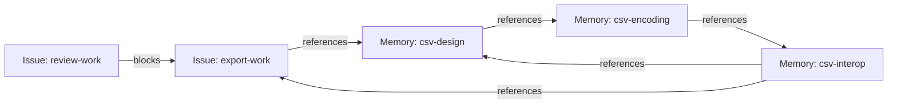
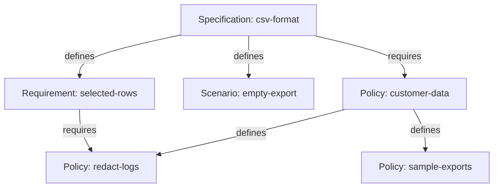

# Working with Tasks and Memories with Preview 3

We just pushed Memory Beads Preview 3 out the door. The first preview was there primarily to demonstrate a happy path through:

1. Generic graph structure that can span issue and non-issue beads. This mode is enabled by passing `--graph-mode link` to `bd init`, which creates a non-production-ready workspace that enables the new features.
2. A set of bead and link types that model how memories are modeled in beads.
3. An implementation of a protocol (BDP) designed to allow bead consumers and producers to interoperate and build graphs that span the scope of a single implementation.

The good news is, it all worked. The meh news is that the happy path was pretty narrow. Preview 2 added no new features; it just made the happy path wider, as does Preview 3. The Preview 3 bits have a lot of undone work that will take weeks and a few previews to grind out. But, Preview 3 has two *very* significant features:

1. Support for importing data from previous versions of beads. You can now export your data from an existing 1.3.* workspace and import it into a new `--graph-mode link` workspace.
2. The first draft of the Bead and Link Types that model how memory will work in beads, along with a memory-specific CLI surface (`bd memory`) for working with these types.

This blog covers both features, starting, of course, with how to bring up a workspace based on your existing data.

<!-- Editorial draft. Current reference build: b27df1b0490bbffadadb399097a3b242d5e0677c. The October 25 namespace checks are separate from the broader October 24 evidence; see review notes. Donna owns release wording and publication. -->

## Creating a `--graph-mode link` workspace from existing data

A new workspace starts out empty. No issue beads. No dependency links. No memory beads.  It's a lonely place that requires a heck of a lot of `bd create` calls to be interesting.

Preview 3 adds support for importing data from a workspace created with version 1.3 of beads into a fresh `--graph-mode link` workspace. Be forewarned that Preview 3 is **not** ready for production work, so import is really here so you can seed your workspace with **a copy** of data you recognize.

### Exporting your existing data

To export your data from an existing workspace, use the familiar `bd export` command from an existing 1.3.* build of `bd` that you either got from your favorite package manager or built from the gastownhall/beads repository.  By default, `export` will only export your issues and dependencies. If you want your memories to come along for the ride, add the `--include-memories` flag. The export command's normal filtering still applies if you want to bring over a subset of your beads and dependencies.

For these transcripts, I used the pinned source build `b27df1b04` in both workspace modes, with two Issues, one Dependency, one comment and one key/value memory in the source. Its version output identifies that source build; use your existing installation when exporting your own data. The export path in the output is shortened with an ellipsis.

/// ok, please show bd list and memories on the export side befoe you export, and the import side on import. Also can you create a couple of dependencies?  it would be good to show that the graph structure survives (and that we can display them using bd link list on the import side.)

```console
# Check the source build in the ordinary workspace.
> bd version
bd version 1.3.0 (b27df1b04: master@b27df1b0490b)

# Export current Issues, dependencies, comments and key/value memories.
> bd export --include-memories --output /tmp/preview3-export.jsonl
Exported 2 issues and 1 memories to …/preview3-export.jsonl
```

An ordinary export carries current data. Earlier revisions, Dolt branches and the source database's history do not come with it. Keep this file unchanged while you test the conversion so that you have a clear source for comparison.

### Importing your data into a new `--graph-mode link` workspace

Switch to the selected Preview 3 executable before preparing the destination. Choose a new directory outside any existing Beads workspace, and initialize Git there so workspace discovery has a local boundary. The Scope URL supplies the workspace's identity; initializing it does not contact or start a web service. Import currently only works on empty workspaces, so perform the import *before* you start calling `bd create` in the new workspace.

```console
# Confirm that this terminal now uses the selected Preview 3 build.
> bd version
bd version 1.3.0 (b27df1b04: b27df1b0490b)

# Create a new practice directory outside the existing workspace.
> mkdir beads-preview3-trial

# Enter the new directory.
> cd beads-preview3-trial

# Give workspace discovery a local Git boundary.
> git init -q

# Initialize a fresh embedded graph workspace with its own Scope identity.
> bd init --graph-mode link --scope-url 'https://example.invalid/preview3-trial/'
Initialized disposable mixed graph preview. Use status --graph for supported commands; no migration or recovery compatibility is promised.

# List all Beads in the new workspace.
> bd list --type any --all
Beads (0; more: false; graph preview)
```

`bd list` shows that you have no Beads. To remedy that, let's pull in your export file to populate the new workspace. Start with a dry-run:

```console
# Validate the export through the import transaction, then roll it back.
> bd import /tmp/preview3-export.jsonl --dry-run --json > import-preview.json

# Inspect the proposed counts and history boundary.
> jq '.result | {dry_run, issues, memories, dependencies, comments, history}' import-preview.json
{
  "dry_run": true,
  "issues": 2,
  "memories": 1,
  "dependencies": 1,
  "comments": 1,
  "history": "current data only; new initial graph versions; source history is not present in legacy export"
}

# Check that the workspace is still empty after the dry-run.
> bd list --type any --all
Beads (0; more: false; graph preview)
```

A successful dry-run reports `dry_run: true`; the following list still shows an empty workspace. The result also includes identity maps for the records the importer accepts. Dry-run reserves nothing, so generated Link IDs are provisional and may differ when you apply the import.

After a successful dry-run, apply the same file and options to the same still-fresh destination. Save the result maps so that you can inspect recognizable Issues and Memories. Use the mixed inventory to check both kinds of Bead: `--all` alone changes Issue status coverage, while `--type any` selects the broader population. Compare content and relationships with the export before relying on the converted copy.

```console
# Apply the same export once to the fresh destination.
> bd import /tmp/preview3-export.jsonl --json > import-result.json


/// uhm where did the comments go on import? I thought we rejected them?  Can we show through the CLI on the import side that they survived?

# Inspect imported record counts and their destination identities.
> jq '.result | {issues, memories, dependencies, comments, ids, memory_ids, dependency_ids}' import-result.json
{
  "issues": 2,
  "memories": 1,
  "dependencies": 1,
  "comments": 1,
  "ids": {
    "legacy-review": "https://example.invalid/preview3-trial/legacy-review",
    "legacy-ship": "https://example.invalid/preview3-trial/legacy-ship"
  },
  "memory_ids": {
    "legacy-encoding": "https://example.invalid/preview3-trial/legacy-encoding"
  },
  "dependency_ids": {
    "legacy-ship -> legacy-review": "https://example.invalid/preview3-trial/xxg7mp"
  }
}

# List Issues and Memories together, including closed Issues.
> bd list --type any --all
Beads (3; more: false; graph preview)
legacy-review [task] open P2 "Check CSV encoding"
legacy-ship [task] open P2 "Ship CSV export"
legacy-encoding [types/memory] "Use UTF-8 for exported files."

# Browse the imported Memories.
> bd memory memories
Memories (1):

  legacy-encoding  Use UTF-8 for exported files.
    Use UTF-8 for exported files. (excerpt)

Title/body summaries. Use bd recall <id> for full text; --details for versions, attribution and Links.
```

Each imported Issue retains its public ID, and its Type is set to the corresponding Bead Type, which refines the common abstract Issue Type. The imported local dependencies become first-class Links of the corresponding Link Type, which refines the common abstract Dependency Type. Existing comments remain in the Issue's comment feed; they do not become Memory Beads.

If you passed the `--include-memories` flag at export time, classic key/value memories get translated to Beads of Type `memory`. The key becomes the memory bead's public ID and the exact value becomes its body, while its title is derived independently from that body. Memory Beads *are not* Issue Beads, and you can't link them using Dependency Links. We'll see later how to build graphs of memory beads with issue beads intermixed.

The importer refuses unsupported or conflicting data as a whole. This includes missing or cross-Scope dependency endpoints, incompatible IDs, unsupported custom Issue classifications or statuses, and source history payloads. Repeating an import into an occupied workspace refuses; deleting records does not make a used destination fresh again. This is a way to seed a new graph workspace, not a lossless in-place migration or portable graph round trip. Support will expand in future previews; this is a point-in-time build.

## Introducing Memory Beads
/// this paragraph is for blog and runbook only - do not bring to spec
This release is the first one containing intentionally designed bead types; Preview 2 had placeholder typenames (`preview-memory`, `preview-references`) that have now been replaced with types we beleive capture the common scenarios (and satisfy the requirements and scenarios laid out in [Chris' memory proposal]). The rest of this blog is a walk through of the new bead types.

Memory Beads record knowledge for later use by both humans and agents. Memory beads can represent policies, requirements, decisions, or generic information that doesn't fit into a particular category.

A Memory Bead has a `title` and a Markdown `body`; its third property (`status`) is optional. Unlike issues, where the status defines a particular lifecycle specific to work tracking, the `status` field on memory beads is free form text and can be used to map onto whatever lifecycle you, your project, or organization use (e.g., PROPOSED, APPROVED, etc).

/// for the runbook, it's great to refer externally to the conceptual material. I'm finding I'm needing provide it here as I go. I'm not sure how to think about that relative to the BDP and CLI specs' frontmatter.  Let's discuss.
References Links let readers gather useful context from a memory graph without turning every connection into a blocking Dependency. The [Memory Type overview](https://github.com/gastownhall/bdp/blob/21fa91d3e189bff3832bd977c3d6be49f2b5d93c/specs/types/memory/memory.md#overview-informative) and [Memory CLI introduction](https://github.com/gastownhall/bdp/blob/1979925130a5744add8e45910c8a64931570bc13/docs/cli-design/memory-cli.md) describe that model; the commands below use the selected Preview 3 build's admitted spellings.

### Record notes and the work they explain

Consider a team adding CSV export to a product. Start with a design note, an encoding note and an interoperability note, each with its own identity. `remember` takes the body as its argument; `--key` selects the same public identity as `--id`, and `--title` supplies readable display text. An identity keeps selecting the same record after its wording changes. This release defines a new top-level command group (`bd memory`) that groups the existing four memory commands (`bd memory remember`, `recall`, `memories` and `forget`) along with addition memory-specific operations. The top-level commands still work; they are aliases to the specific commands under `bd memory`.  That is, calling `bd remember` and `bd memory remember` are the same.

Here is an example that create the three memory beads.
```sh
# Record the CSV design under an explicit identity and title.
bd memory remember 'Export the selected rows as CSV.' \
  --key csv-design --title 'CSV export design' --create-only

# Record the encoding note that the design will reference.
bd memory remember 'Use UTF-8.' \
  --key csv-encoding --title 'CSV encoding' --create-only

# Record the spreadsheet checks that tie design decisions to implementation.
bd memory remember 'Test the exported UTF-8 file in spreadsheet tools; keep the results with the implementation work.' \
  --key csv-interop --title 'CSV interoperability checks' --create-only

```

/// WARNING/ERROR: I thought we got rid of the types/ prefixes (along with beads/ and links/)


The general Bead command can create the same kind of note by selecting its installed Type.
```sh
# Alternatively, create the design note through the general Bead command.
bd create --id csv-design --type types/memory \
  --properties '{"title":"CSV export design","body":"Export the selected rows as CSV."}'

```

/// I would follow this paragraph with an example, showing a two bd remmbers with the same key, followed by the equivalent bd create|update calls. Then show that the bd remember --create-only on the same key fails.  I think that example obviates the need for the previous example
The `bd remember` command supported both creating new memories and updating existing ones. That continues to work, however to allow callers to specify whether updating is allowed, the new `--create-only` causes the command to fail. /// no need to introduce type updates here.

/// this example confuses the crap out of me. I would have shown the recall/show, forget/delete and memories/list comps (with some explanatory prose preceding each one), all the time emphasizing that memories and now beads

/// see previous comment about refactoring this.
The notes hold knowledge; Issues record the work of implementing and reviewing the feature. The fixed practice IDs below use `--force` to allow a spelling outside the workspace's configured native Issue prefix. We can then inspect a Memory as a Bead, recall just its body, or browse summaries to choose what to read.


```sh
# Create the implementation Issue.
bd create 'Add CSV export' --id export-work --type task --force \
  --description 'Implement CSV export for the selected rows.'

# Create the review Issue.
bd create 'Review CSV export' --id review-work --type task --force \
  --description 'Review the completed CSV export feature.'

# Read the design note's body.
bd memory recall csv-design

# Browse Memories whose content mentions CSV.
bd memory memories CSV

# Read the same design note as a complete Bead.
bd show csv-design

```

### Connect context, including cycles


References explain useful connections between knowledge and work. The feature design uses the encoding note, the encoding note points to interoperability checks, and those checks refer back to the design. The checks also point to the implementation Issue, which refers to the design it implements. This gives us one cycle entirely among Memories and another that passes through an Issue; neither is a blocking Dependency.

/// please explain that `bd memory reference` and `bd dep add`  are just aliases over the generic bd link create command. No need to show an example, but please use bd dep add for the last link in this list

```sh
# Explain which encoding note the design uses.
bd memory reference csv-design csv-encoding --id encoding-context \
  --title 'Uses this encoding' --body 'Text encoding for exported files'

# Connect the encoding choice to its spreadsheet checks.
bd memory reference csv-encoding csv-interop --id encoding-checks \
  --title 'Interoperability checks for this encoding'

# Close the cycle among the three Memories.
bd memory reference csv-interop csv-design --id checks-design \
  --title 'Design these checks validate'

# Connect the interoperability checks to the work recording their results.
bd memory reference csv-interop export-work --id checks-work \
  --title 'Implementation and verification work'

# Close the cycle that passes through the implementation Issue.
bd memory reference export-work csv-design --id design-context \
  --title 'Implementation context'

# Make review wait for the implementation Issue to finish.
bd link create review-work export-work --type blocks --id review-after-export

```

References links are allowed to create cycles. A traversal stops expanding a Bead it has already visited and keeps the Links that show the relationship, including a cycle-closing Link. The `blocks` Dependency retains its existing workflow meaning: in this case review waits for implementation.



A plain References Link has its own revision; adding or editing it does not revise either endpoint. Use a forward read to find context, or a reverse read to find records referring to a note. The graph viewer can follow the current References family across the connected example.

/// I really wonder if we should apply the `>`/output format used in the import section.  What the heck does bd graph show?  We also should talk about what the link-type flag does (wihtout explaining exact-type here)

```sh
# Find the design note's direct References.
bd memory references csv-design

# Find Beads that refer to the design note.
bd memory referenced-by csv-design

# Explore the References graph far enough to encounter both cycles.
bd graph csv-design --link-type types/references --direction out --depth 4

```

### Revise a note or replace it

An edit maintains the same piece of knowledge under the same identity. Each accepted change saves a new revision, while an unchanged update leaves the revision alone. A separately maintained replacement is a different Memory, connected to the old one by a Superseded By Link. These operations answer different questions: what changed in this note, and which note should I follow next?

/// Darn I wish we would have added bd memory update with --body/--title/--subject. Can you check with Janet whether its there and ask her if it's worth adding for PR3?  Either way, I think this would read better as bd remember - the JSON looks ugly
```sh
# Clarify the encoding note while keeping its identity.
bd update csv-encoding --properties '{"body":"Use UTF-8 without a byte-order mark."}'

# Rename the note and label it reviewed in one edit.
bd update csv-encoding --properties '{"title":"CSV text encoding","status":"reviewed"}'

# List the saved revisions of this identity.
bd versions csv-encoding

# Read the second saved revision created by this example.
bd show csv-encoding@2

# Recall just the body from that saved revision.
bd memory recall csv-encoding@2

```


//// WHOA WHOA WHOA WHOA WHOA.  First, we shoud NOT introduce pinned references UNTIL we discuss the overall revision model and ID@rev syntax.  I have to say, I could swear I've read AND written that section at least once.  I am going to stop editing and sort out with you what happned with that prose and whether we ahve the right document<->document flow.

Use the actual revision numbers and opaque tokens reported by your store. `@2` selects a store-local revision number; `@=TOKEN` selects the exact token for a portable citation. A retained Resource revision does not reconstruct an entire past graph, and this preview's focused Memory relationship reads can refuse endpoint pins that no longer match the captured current state.

```sh
# Record a separately maintained guide that replaces the short note.
bd memory remember 'Encoding, headings and spreadsheet examples.' \
  --key csv-guide --title 'CSV interoperability guide' --create-only

# Connect the retiring note to its replacement.
bd memory supersede csv-encoding csv-guide --id encoding-replacement

# Follow the replacement path from the old note.
bd memory successor csv-encoding

# Find the direct predecessors of the replacement guide.
bd memory supersedes csv-guide

```

The Link points from old to new, revises the retiring Memory and leaves the replacement unchanged. The old identity and earlier revisions remain readable, and existing References keep their targets until their authors change them. Each retiring Memory has at most one successor, and replacement chains cannot cycle.

## Give constraints a structure

Some knowledge states what work must do, avoid or follow. A Constraint Bead records such an obligation in its body, and its Type tells a reader what kind of rule it is. Policy, Decision, Procedure, Requirement, Scenario and Specification refine Constraint, which itself refines Memory. Use Constraint directly when none of those more specific Types fits; a metadata label does not create Type membership.

| Type | What it records |
| --- | --- |
| Policy | Governing rules for a system, project or team. |
| Decision | Choices that constrain later work. |
| Procedure | How work is carried out, with the flow in its body. |
| Requirement | An outcome or condition that must be met. |
| Scenario | Required behavior in a particular situation. |
| Specification | Intended results at any useful level of detail. |

### Define the parts and require other rules

For CSV export, a Specification can define a selected-row Requirement and an empty-selection Scenario. A customer-data Policy can remain independently maintained and govern many features. Its detailed Policies belong to its own definition, even when another Requirement also relies on one of them. Each record has its own identity and can be revised or referenced independently.

```sh
# Describe the feature's intended result.
bd create 'CSV export format' --id csv-format --type types/specification \
  --body 'Export selected rows and follow the rules linked below.'

# State which rows must appear in the output.
bd create 'Export every selected row' --id selected-rows --type types/requirement \
  --body 'Every selected row appears exactly once.'

# State the expected outcome for an empty selection.
bd create 'Export an empty selection' --id empty-export --type types/scenario \
  --body 'Produce headings and no data rows.'

# Record the independently maintained customer-data Policy.
bd create 'Protect customer data' --id customer-data --type types/policy \
  --body 'Keep personal information out of logs and shared sample exports.'

# Record the Policy's log-handling detail.
bd create 'Redact application logs' --id redact-logs --type types/policy \
  --body 'Remove personal information before writing log entries.'

# Record the Policy's sample-data detail.
bd create 'Use anonymized sample exports' --id sample-exports --type types/policy \
  --body 'Use anonymized records in shared sample exports.'

```

Defines makes a child part of its parent's definition. Requires names another Constraint that must also be met, including one maintained in a separate defining tree. Defines refines Requires, so a Requires-family read includes both kinds of Link without changing their labels.

```sh
# Make the selected-row Requirement a defining part of the Specification.
bd memory defines csv-format selected-rows --id defines-rows

# Make the empty-selection Scenario another defining part.
bd memory defines csv-format empty-export --id defines-empty

# Give the customer-data Policy its log-handling detail.
bd memory defines customer-data redact-logs --id defines-logs

# Give the customer-data Policy its sample-data detail.
bd memory defines customer-data sample-exports --id defines-samples

# Require the independently maintained Policy from the Specification.
bd memory requires csv-format customer-data --id requires-policy

# Require the same log-handling Policy from the selected-row Requirement.
bd memory requires selected-rows redact-logs --id requires-log-policy

```

The two defining trees remain distinct. The selected-row Requirement can require the log-handling Policy without becoming its defining parent. A Defines child has at most one defining parent, and defining trees cannot cycle; Requires can cross between trees and may cycle, with repeated expansion stopped during a read.



Both kinds of Link are owned by their source Constraint. A Link change revises that source without revising the target. The following reads distinguish the Specification's own defining parts from the broader set of constraints it requires.

```sh
# Read the Specification's defining Requirement and Scenario.
bd memory definition csv-format

# Discover its defining parts and the independently maintained Policies it requires.
bd memory requirements csv-format

# Find the selected-row Requirement's direct defining parent.
bd memory defined-by selected-rows

# Find Constraints that directly require the log-handling Policy.
bd memory required-by redact-logs

```

### Declare which work is governed

A Subject To Link explicitly declares that a Constraint governs a Bead. The implementation Issue and a Memory describing a preview build can both be subject to the CSV Specification. Starting with either subject, a focused read follows the declared Constraints and their Requires family, including Defines. The paths tell a reader how each rule was reached.

```sh
# Record the preview build as a second kind of subject.
bd memory remember 'The CSV preview build is ready for review.' \
  --key csv-preview --title 'CSV preview build' --create-only

# Declare the Specification governing the implementation Issue.
bd memory subject-to export-work csv-format --id work-obligation

# Declare that the same Specification governs the build Memory.
bd memory subject-to csv-preview csv-format --id build-obligation

# Discover the rules explicitly governing both subjects.
bd memory constraints export-work csv-preview

# Find the subjects that directly declare the CSV Specification.
bd memory subjects csv-format

```

Subject To is owned by its source, so a Link change revises the subject while leaving the Constraint unchanged. It does not spread through another Subject To declaration: a document-review Policy governing the Specification does not automatically govern its implementation Issue. These declarations help people and agents discover governing rules; they do not execute prose, prove compliance or change Issue readiness.

## Read a proposal as structured knowledge

A substantial proposal contains several kinds of knowledge: an explanation of its purpose, requirements that constrain the design, and scenarios that describe its expected use. [Chris's Memory proposal](https://github.com/gastownhall/beads/issues/5877) gives us a concrete example. We can represent it as one Specification, with 32 Requirement Beads and 16 Scenario Beads as its defining children. Each child retains its original text and complete title, including its `Rn` or `Sn` prefix; R27a accounts for the extra Requirement beyond R1–R31.

### Start with the Specification

For this example, use a separate, focused Scope containing the proposal and its extracted Beads. The [example data](preview3-blog-assets/memory-proposal-data.json) retains the complete source titles and bodies; it is editorial example data, not a format accepted by `bd import`. The Specification's introductory body is newly authored prose, while the children carry the actual proposal text. The compact displays below illustrate the arrangement and abbreviate long titles for the page; they are not an exact terminal transcript or a claim that the entire proposal has been implemented.

```sh
# Read the Specification's title and introductory body.
bd show memory-proposal

```

```text
ID:       memory-proposal
Type:     specification
Title:    Memory Beads
Revision: [current revision]

Keep durable project knowledge in Beads so people and agents can
find it, read it selectively, and understand its relationship to
their work.

Give each Memory a persistent identity and its own content.
Preserve its evolution through recorded revisions, and connect it
to tasks and other knowledge through explicit Links.

The defining Requirements and Scenarios describe the proposed
behavior. They can be read individually or explored together
through this Specification.
```

The introductory body gives readers a starting point without making them read every detail. The Requirements and Scenarios remain independently addressable, so a discussion or implementation task can refer to a particular part of the proposal.

```sh
# List Requirement Beads in this focused Scope.
bd list --type requirement

```

```text
ID           TYPE          TITLE
memory-r1    requirement   R1. Memory is a…
memory-r2    requirement   R2. Canonical identity does…
…
memory-r30   requirement   R30. Core preserves evidence…
memory-r31   requirement   R31. Every target addition…
```

These excerpts show the first two and last two entries in the proposal's order. R27a and the other intervening Requirements are present in the stored data. This presentation order does not promise automatic numeric sorting by the CLI.

```sh
# List Scenario Beads in this focused Scope.
bd list --type scenario

```

```text
ID           TYPE       TITLE
memory-s1    scenario   S1. Record durable knowledge…
memory-s2    scenario   S2. Search before writing…
…
memory-s15   scenario   S15. Temporary knowledge carries…
memory-s16   scenario   S16. An application…
```

The ellipses shorten this presentation; the stored titles and bodies remain complete. In a shared Scope, these commands would also list other matching Beads: the Type filter does not select membership in this particular Specification.

### Follow the definition and its requirements

The lists show what exists, but they do not explain how those Beads form a document. Defines Links make each extracted Requirement and Scenario part of the Specification's definition. Both kinds of child are directly defined by the root Specification, as siblings. A Scenario may exercise several Requirements, so its place in the document does not force it to belong to just one of them.

```sh
# Explore the Specification's defining Requirements and Scenarios.
bd memory definition memory-proposal

```

```text
memory-proposal [specification]
├─ defines → memory-r1  [requirement]
├─ defines → memory-r2  [requirement]
│  …
├─ defines → memory-r30 [requirement]
├─ defines → memory-r31 [requirement]
├─ defines → memory-s1  [scenario]
├─ defines → memory-s2  [scenario]
│  …
├─ defines → memory-s15 [scenario]
└─ defines → memory-s16 [scenario]
```

Defines is a refinement of Requires: a defining child is something that must be met for its parent to be met. The broader requirements read therefore includes the same defining children, along with any additional Requires Links. It preserves `defines` labels rather than relabeling those edges as `requires`.

```sh
# Discover the Specification's defining parts and any other required Constraints.
bd memory requirements memory-proposal

```

With only the Defines Links shown above, this read reaches the same children. If the Specification later requires an independently maintained Policy, that Policy appears in this broader view without becoming part of the Specification's defining tree. The proposal's S-number citations do not automatically create dependency Links among the extracted children.

```sh
# Read the first Requirement's title and complete content.
bd show memory-r1

# Read the first Scenario's Markdown body.
bd memory recall memory-s1

```

Each extracted Bead can be discussed, referenced and revised independently. The Specification preserves its relationship to the proposal, while the body carries the actual meaning. Discovering a Requirement establishes what must be met, not that anyone has met it.

## Where Are We

Preview 3 contains a lot of CLI changes and underlying infrastructure work. We are driving toward the requirements set out in [Chris's Memory proposal](https://github.com/gastownhall/beads/issues/5877) and have made steady progress.

Some major areas still need more work:

- Fleshing out how to define and register new Bead and Link types. Preview 3 uses a selected graph Type catalog; arbitrary user-authored Bead and Link Type installation is unfinished.
- Implementing the full provenance capabilities outlined in the Memory proposal. Recorded change attribution is available, but the complete provenance surface is unfinished.
- Implementing the rest of BDP to support the federation requirements outlined in Chris's proposal. The qualified preview surface covers BDP Read; HTTP writes, BDP History, and cross-Scope Links remain outside that surface.
- Ensuring that the entire Bead, Link, Issue, and Dependency surface works consistently.
- Ensuring that the remaining operational parts of the CLI work with and respect the new features and capabilities we are introducing.

Work on these areas is underway, but the full capabilities aren't ready for prime time. If your curiosity has you spelunking in those areas, prepare to be surprised in future previews.

Once again, try the workflow on a small disposable copy of a project and tell us where it helps or gets in your way. Join the conversation in the [Gas Town Hall Discord](https://discord.gg/xHpUGUzZp2), in the `#beads` and `#memory-beads` channels, or [file a Beads issue](https://github.com/gastownhall/beads/issues) with a `[Memory]` prefix. Feedback on the protocol itself can go straight to the [BDP repo](https://github.com/gastownhall/bdp/issues). Include the integration commit you tried so we can reproduce what you saw.
